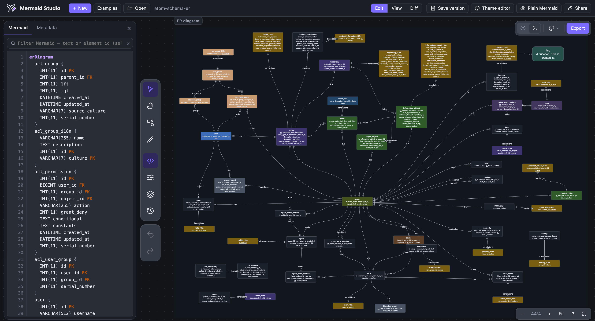

<p align="center">
  <picture>
    <source media="(prefers-color-scheme: dark)" srcset="brand/logo-dark.svg">
    
  </picture>
</p>

<h1 align="center">Mermaid Studio (mmdx)</h1>

<p align="center">Visual editor, viewer, theme editor and visual diff for Mermaid diagrams, as framework-agnostic web components.<br>Mermaid stays the source of truth — layout and styling live in comment lines every Mermaid renderer ignores.</p>

<p align="center">
  <a href="https://github.com/udamir/mmdx/actions/workflows/ci.yml"></a>
  <a href="https://www.npmjs.com/package/@mmdx/studio"></a>
  <a href="LICENSE"></a>
</p>

<p align="center"><a href="https://udamir.github.io/mmdx/"><b>Documentation</b></a> · <a href="https://udamir.github.io/mmdx/studio/"><b>Live demo</b></a> · <a href="https://udamir.github.io/mmdx/storybook/"><b>Storybook</b></a></p>

<p align="center"><a href="https://udamir.github.io/mmdx/studio/"></a></p>

---

Mermaid's auto-layout and styling are hard to control. Mermaid Studio lets you lay out and style a diagram by hand and stores the result as `%%@` comment lines in the same Mermaid text. The file stays valid Mermaid: GitHub, GitLab or any stock renderer still draws it, and Mermaid Studio draws it exactly as you arranged it.

## Features

- **Visual editing** of flowcharts, sequence diagrams and ER diagrams, two-way with the Mermaid code.
- **Viewer** for documentation: pan, zoom, layers, full screen, export, server-side rendering to SVG.
- **Visual diff and history**: how a diagram changed between versions, in the browser or in CI.
- **Themes** with a theme editor; diagrams follow light and dark.
- **Export** to `.mmdx`, portable `.mmd`, SVG and PNG.
- **Framework-agnostic** custom elements, **secure by default** (untrusted input, strict CSP).

## Install

```bash
npm install @mmdx/studio
```

## Quick start

```html
<script type="module">
  import '@mmdx/studio/viewer';
</script>

<mmdx-viewer controls="zoom layers fullscreen export">
  <script type="text/mermaid">
    flowchart LR
      a[Start] --> b{Check} --> c[Done]
  </script>
</mmdx-viewer>
```

```ts
import '@mmdx/studio/editor';
import { httpDocumentAdapter } from '@mmdx/studio/adapters';

document.querySelector('mmdx-editor')!.adapter = httpDocumentAdapter('/api/diagrams/architecture.mmdx');
```

See [Getting started](https://udamir.github.io/mmdx/guide/getting-started.html) for the editor, the diff, server-side rendering and frameworks.

## Documentation

- [Guide](https://udamir.github.io/mmdx/guide/introduction.html): the `.mmdx` format, themes, documents and history, Markdown, frameworks, sandboxed iframes, security
- [Components](https://udamir.github.io/mmdx/components/): `<mmdx-viewer>`, `<mmdx-editor>`, `<mmdx-diff>`, `<mmdx-theme-editor>`, `<mmdx-studio>`
- [API](https://udamir.github.io/mmdx/api/): entry points, core, adapters, events, the theme file
- [Changelog](CHANGELOG.md)

## Development

```bash
pnpm install
pnpm dev        # the studio at http://localhost:8790
pnpm test
```

See [Contributing](https://udamir.github.io/mmdx/guide/contributing.html) for every command and the repository layout.

## License

[MIT](LICENSE)
