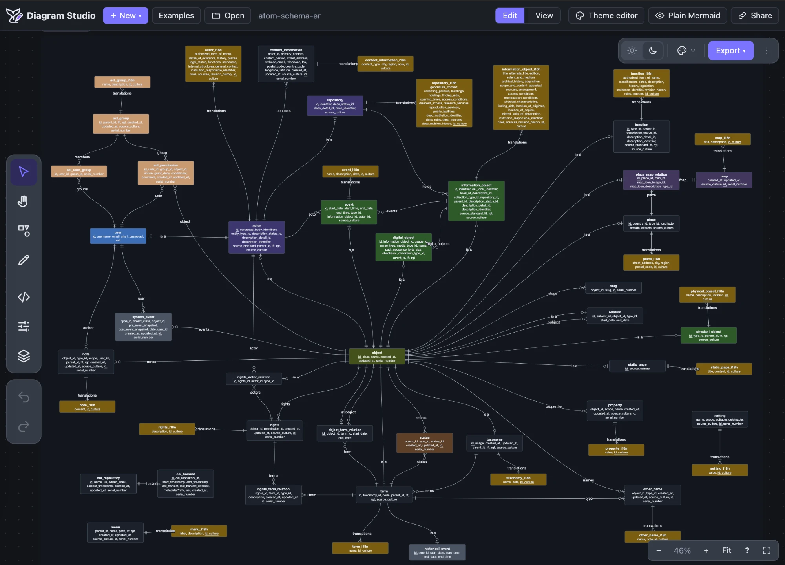

<p align="center">
  <picture>
    <source media="(prefers-color-scheme: dark)" srcset="brand/logo-dark.svg">
    
  </picture>
</p>

<h1 align="center">Diagram Studio (mmdx)</h1>

<p align="center">Visual editor, viewer and theme editor for Mermaid diagrams, as framework-agnostic web components.<br>Mermaid stays the source of truth — layout and styling live in comment lines every Mermaid renderer ignores.</p>

<p align="center">
  <a href="https://github.com/udamir/mmdx/actions/workflows/ci.yml"></a>
  <a href="https://www.npmjs.com/package/mmdx"></a>
  <a href="LICENSE"></a>
</p>

<p align="center"><a href="https://udamir.github.io/mmdx/"><b>Live demo</b></a></p>

<p align="center"><a href="https://udamir.github.io/mmdx/"></a></p>

---

## Why

Mermaid is great for keeping diagrams in docs and repos, but its auto-layout and styling are hard to control. Diagram Studio lets you lay out and style a Mermaid diagram by hand — drag boxes, route connectors, pick colours and presets — and stores the result as `%%@` comment lines appended to the same Mermaid text. The file stays valid Mermaid: GitHub, GitLab, YouTrack, Notion or any stock Mermaid renderer still draws it (with its own layout), and Diagram Studio draws it exactly as you arranged it.

## Features

- **Three diagram types, edited visually:** flowchart, sequence diagram and ER diagram. Other Mermaid types are shown with stock Mermaid.
- **Two-way editing:** everything you do on the canvas is written back to the Mermaid code, and code edits update the canvas live. Structure (nodes, edges, participants, tables) always lives in Mermaid; metadata holds only positions and looks.
- **Canvas tools:** drag, resize, snap, align and distribute, groups (`subgraph` / `box`), connectors with magnet points and bend points, copy / paste / duplicate, copy style, z-order, layers, undo / redo, presenting pen.
- **Styling:** a floating toolbar and a Properties panel for fill, border, text, font, shape, stacking, arrows, line shape and more; named style presets from the theme or saved per diagram.
- **Themes:** separate theme files with a colour palette, per-type styles and presets. Colours are stored as palette references, so a diagram follows theme switches. Light and dark themes are linked, so a diagram switches with the page.
- **Viewer for documentation:** pan, zoom, layers, full screen, export, lazy rendering, a text outline for screen readers, and server-side rendering to SVG.
- **Theme editor:** edit the palette and every item type's style with live previews, check text contrast, import and export `.theme.json` files.
- **Export:** `.mmdx` (Mermaid + layout), portable `.mmd` (`classDef` / `linkStyle` so stock renderers keep the colours), SVG and PNG.
- **Framework-agnostic:** custom elements in shadow DOM, usable from plain HTML, React, Vue, Angular or Svelte, plus imperative classes where custom elements are not allowed.
- **Secure by default:** diagram text and theme files are treated as untrusted input; no `innerHTML`, a link policy, size limits and a strict CSP are supported.

## Install

```bash
npm install mmdx
# optional: only needed for diagram types mmdx does not draw itself, and the "Plain Mermaid" preview
npm install mermaid
```

The package is ESM only (ES2022). It has no runtime dependencies; `mermaid` (≥ 10) is an optional peer dependency loaded lazily.

## Quick start

### Show a diagram

```html
<script type="module">
  import 'mmdx/viewer';
</script>

<mmdx-viewer controls="zoom layers fullscreen export">
  <script type="text/mermaid">
    flowchart LR
      a[Start] --> b{Check} --> c[Done]
  </script>
</mmdx-viewer>

<!-- or load a file -->
<mmdx-viewer src="/diagrams/architecture.mmdx" theme-dark="auto"></mmdx-viewer>
```

### Edit a diagram

```ts
import 'mmdx/editor';
import { httpDocumentAdapter } from 'mmdx/adapters';

const editor = document.querySelector('mmdx-editor')!;
editor.adapter = httpDocumentAdapter('/api/diagrams/architecture.mmdx'); // load + save with If-Match conflict detection
editor.addEventListener('ds-dirty', (e) => setUnsaved(e.detail.dirty));
```

```html
<mmdx-editor guard-unload style="height: 640px"></mmdx-editor>
```

Without an adapter, set `editor.value = source` and read changes from the `ds-change` event.

### Render on the server or at build time

```ts
import { renderToSvg } from 'mmdx/core';

const svg = await renderToSvg(source, { theme: 'default-dark' }); // a standalone SVG string, no DOM needed
```

## Entry points

| Import | Provides |
|---|---|
| `mmdx/viewer` | `<mmdx-viewer>` and `DiagramViewer` — read-only diagrams for docs and portals |
| `mmdx/editor` | `<mmdx-editor>` and `DiagramEditor` — the visual editor with the code panel |
| `mmdx/theme-editor` | `<mmdx-theme-editor>` and `ThemeEditor` — manage diagram themes |
| `mmdx/studio` | `<mmdx-studio>` and `DiagramStudio` — the complete standalone app (the live demo) |
| `mmdx/core` | Pure API without DOM: parse, render to SVG, metadata, themes (Node, workers, browsers) |
| `mmdx/adapters` | Storage, theme sources and stores, document adapters, share links |
| `mmdx/markdown` | rehype and markdown-it plugins that turn ` ```mermaid ` blocks into viewers |
| `mmdx/react` | Optional typed wrappers for React ≤ 18 |
| `mmdx/themes/*` | The built-in theme files (`default-light.theme.json`, …) |

Importing an element entry registers its tag once (importing it twice is safe), and importing any entry in Node does not throw, so server-side rendering frameworks can import them. Each element is also an imperative class you can mount on any element, for hosts where `customElements.define` is not allowed:

```ts
import { DiagramViewer } from 'mmdx/viewer';
const viewer = new DiagramViewer(hostElement, { source, controls: ['zoom', 'fullscreen'] });
```

## Components

### `<mmdx-viewer>`

| Attribute / property | Default | Meaning |
|---|---|---|
| `src` / `source` (property) / inline `<script type="text/mermaid">` | — | The diagram. `src` is fetched through `loader` (property, default `fetch`) |
| `theme` | the diagram's own | Forces a theme over the diagram's `canvas.theme` |
| `theme-dark` | — | Theme used on dark pages; `auto` picks the dark theme linked to the diagram's theme |
| `fit` | `width` | `width` (height follows), `contain` (fit a fixed box) or `none` (natural size) |
| `controls` | `zoom fullscreen` | Any of `zoom layers pen code export fullscreen`, or `none` |
| `interactive` | `true` | `false` turns off pan and zoom (thumbnails, print) |
| `lazy` | `true` | Render when scrolled near; the box keeps the diagram's aspect ratio meanwhile |
| `wheel` | `ctrl` | `ctrl`: only ⌘/Ctrl+wheel zooms, so page scroll is never trapped; `always`; `never` |
| `fallback` | `mermaid` | For unsupported types: stock Mermaid, `source` or `error` |
| `layers` (property) | from metadata | Visible layer ids |
| `labels`, `hover-highlight` | `true` | Show connector labels; highlight connected items on hover |
| `label` | generated | Accessible name, e.g. "Flowchart: 12 nodes, 14 connections" |
| `ui` | `auto` | Chrome colour scheme: `light`, `dark` or `auto` |

Events (bubbling, composed): `ds-render` `{ bounds, type, durationMs }`, `ds-error` `{ diagnostics }`, `ds-link` `{ href, id }` (cancelable, to route links through your router), `ds-fullscreen` `{ active }`. Methods: `fit()`, `zoomTo(k)`, `reload()`, `toSvg()`, `toPng({ scale })`, `setLayers(ids)`.

Keyboard, while the viewer has focus: `+` / `-` zoom, `F` or `0` fits, arrows pan, `P` toggles the pen, `Esc` stops it. `controls="code"` adds a code view: the diagram's Mermaid code without the layout metadata and styles, highlighted, with a Copy button.

Each diagram type's parser and renderer load on first use, and diagrams over 300 lines render in a module worker (`setWorkerUrl(url)` lets a strict-CSP host serve the worker file).

### `<mmdx-editor>`

| Attribute / property | Default | Meaning |
|---|---|---|
| `adapter` (property) | — | `DocumentAdapter` `{ load, save, subscribe? }`: Save button, ⌘S, conflict dialog, live updates |
| `value` (property) | — | The source when there is no adapter |
| `read-only` | `false` | View mode only |
| `features` (property) | all on | Turn parts off: `codePanel`, `properties`, `layers`, `pen`, `styleToolbar`, `export`, `themePicker`, `help`, … |
| `panels` (property) | remembered | Which side panels are open: `{ code, properties, layers }` |
| `storage` (property) | `localStorage` (`ds.` keys) | Where UI preferences are kept; never the document |
| `autosave` | off | Debounced save through the adapter, in ms |
| `guard-unload` | off | Ask before leaving the page with unsaved changes |
| `name` | `diagram` | File name for exports |

Events: `ds-change` `{ source, reason }`, `ds-dirty` `{ dirty }`, `ds-save` (cancelable, to save yourself), `ds-saved`, `ds-conflict`, `ds-op` (cancelable, every edit), `ds-selection`, `ds-export` (cancelable), `ds-edit-themes`, `ds-ui`, `ds-error`. Methods: `getSource()`, `setSource(src, { history: 'reset' | 'push' })`, `save()`, `undo()`, `redo()`, `select(items)`, `focusCode(line)`, `exportAs('mmdx' | 'mmd' | 'svg' | 'png')`, `fit()`.

Saving: `ds-save` → `adapter.save(source, { version })` → `ds-saved`; when the adapter reports a conflict, a dialog offers to keep yours, take theirs or compare both. Remote updates from `adapter.subscribe` apply directly (and can be undone) while the editor has no unsaved changes; otherwise a bar offers *Reload* or *Keep mine*.

Shortcuts work while focus is inside the editor: `V` `H` `S` `P` `C` `I` `L` switch tools and panels, `F` fits, `?` lists every shortcut, Space+drag pans, ⌘Z / ⇧⌘Z undo and redo, ⌘A / ⌘C / ⌘V / ⌘D select all, copy, paste and duplicate, ⌘⌥C / ⌘⌥V copy and paste a style, ⌘G / ⇧⌘G group and ungroup, ⌘[ / ⌘] change the order, Del deletes, arrows move by 1 px (Shift: 10 px), Enter edits text, Esc goes back. On Windows and Linux use Ctrl for ⌘.

Built-in adapters (`mmdx/adapters`): `httpDocumentAdapter(url)` (GET / PUT with ETags) and `memoryDocumentAdapter(source, name)`. Write your own for any backend:

```ts
const adapter: DocumentAdapter = {
  load: async () => api.get(id),                                    // { source, version? }
  save: async (source, { version }) => api.put(id, source, version), // { version? } or { conflict: { source, version } }
};
```

### `<mmdx-theme-editor>`

```ts
import 'mmdx/theme-editor';
import { fetchThemeSource, localStorageAdapter, localStorageThemeStore } from 'mmdx/theme-editor';

const base = fetchThemeSource('/themes/index.json');  // read-only themes to start from
const te = document.querySelector('mmdx-theme-editor')!;
te.store = localStorageThemeStore(localStorageAdapter(), base); // or your own ThemeStore: list, get, save, delete?, publish?
te.source = base;
```

Attributes: `theme`, `can-edit`, `can-publish`, `can-delete`, `presentation="inline | dialog"`, `ui`. Events: `ds-theme-save` (cancelable), `ds-theme-saved`, `ds-theme-dirty`, `ds-theme-select`, `ds-theme-close`. Saved themes are validated and registered in the shared registry, so open viewers and editors redraw with them.

### `<mmdx-studio>`

The complete app — editor, examples, file open, theme editor and share links — in one element:

```html
<mmdx-studio examples="./examples/index.json" themes="./themes/index.json" persist="local hash"></mmdx-studio>
```

`persist="local"` keeps the last document in browser storage; `persist="hash"` keeps it in the URL, which the Share button copies.

## The `.mmdx` format

A `.mmdx` file is a Mermaid diagram followed by `%%@` lines, one per styled or placed item. Each line is `%%@ <kind> <id> <JSON>`:

| Line | Holds |
|---|---|
| `%%@ canvas {…}` | Theme, page size and proportions, page background, routing default |
| `%%@ node <id>`, `group <id>`, `edge <from>-><to>` | Flowchart item position, size, preset and style overrides |
| `%%@ participant <id>`, `message m1`, `note n1`, `block b1`, `activation B:1` | Sequence diagram items |
| `%%@ entity <name>`, `rel <A>--<B>` | ER tables and relationships |
| `%%@ style.<kind> <name> {…}` | A style preset defined in this diagram |
| `%%@ layer <id> {"name":…,"hidden":…}` | A user-defined layer |

Messages, notes and blocks are numbered in source order; repeated edges get `#2`, `#3`. Items without a position are laid out automatically and keep their place once moved.

A style is resolved in this order, later wins: the theme's base style → the shape's default → the preset (from metadata or a Mermaid class such as `A:::core`) → Mermaid `classDef` / `style` / `linkStyle` → the item's own metadata.

Plain `.mmd` files open too (they simply have no `%%@` lines), and **Export → portable Mermaid** writes a `.mmd` with generated `classDef` / `linkStyle` lines, so stock renderers show the colours.

## Themes

A theme is a JSON file with a colour palette, the default style of every item type, named presets and page settings. Only the base theme defines everything; other themes `extend` it and store only what they change.

```json
{
  "id": "ocean",
  "name": "Ocean",
  "extends": "default-light",
  "appearance": "light",
  "counterpart": "ocean-dark",
  "palette": { "sky": "#cfe8ff", "ink": "#0b2545" },
  "flowchart": { "node": { "radius": 12 }, "nodePresets": { "core": { "fill": "@sky" } } }
}
```

Built-in themes, as light / dark pairs:

| Light | Dark |
|---|---|
| Default Light (`default-light`) | Default Dark (`default-dark`) |
| GitHub Light (`github-light`) | GitHub Dark (`github-dark`) |
| Catppuccin Latte (`catppuccin-latte`) | Catppuccin Mocha (`catppuccin-mocha`) |
| Rosé Pine Dawn (`rose-pine-dawn`) | Dracula (`dracula`) |

Default Light and Default Dark are bundled; the others are loaded from `mmdx/themes/*` or any manifest you point `configure({ themeSource })` at. Colours in diagrams are stored as palette references (`@sky`) or as a palette colour plus a shift (`@sand~=349.3,+53.5,-5.7`), so a diagram restyles itself when its theme changes. 

| Theme key | Holds |
|---|---|
| `id`, `name`, `extends` | Identity and the theme it builds on (`default-light` when omitted) |
| `appearance`, `counterpart` | `light` or `dark`, and the linked theme of the other appearance |
| `palette`, `font` | Named colours (`"sky": "#cfe8ff"`, referenced as `@sky`) and the font stack |
| `canvas` | Page padding, background, grid and border |
| `flowchart` | `node`, `group`, `edge`, their `…Presets`, `nodeShapes` (per-shape defaults) and `pagePresets` |
| `sequence` | `participant`, `message`, `note`, `block`, `box`, `lifeline`, `activation`, their `…Presets`, `participantShapes`, `layout` and `pagePresets` |
| `er` | `entity`, `rel`, their `…Presets` and `pagePresets` |

Every theme names a linked theme of the other appearance (`counterpart`), and the editor's light / dark toggle shows a diagram in the linked theme of its own; a theme without a link falls back to Default Light ↔ Default Dark. This is a display choice: the file keeps its theme. Theme files are validated when loaded or saved, and invalid values are dropped with a diagnostic.

## Configuration

```ts
import { configure } from 'mmdx/viewer'; // also exported by the editor, theme editor and studio entries
import { fetchThemeSource } from 'mmdx/adapters';

configure({
  themeSource: fetchThemeSource('/themes/index.json'),   // themes a diagram names but the page has not loaded
  i18n: { locale: 'de', messages: { 'zoom.fit': 'Einpassen' } },
  linkPolicy: { protocols: ['https:', 'mailto:'], target: '_blank' },
  fonts: { Inter: '/fonts/inter.woff2' },                 // embedded into PNG exports
  mermaid: () => import('mermaid').then((m) => m.default),
});
```

## Markdown and documentation sites

```ts
import { rehypeMmdx, markdownItMmdx } from 'mmdx/markdown';

// unified / rehype (Astro, Docusaurus, VitePress…)
rehypePlugins: [[rehypeMmdx, { themeDark: 'auto' }]]
// markdown-it
md.use(markdownItMmdx, { attrs: { controls: 'zoom fullscreen' } });
```

Each ` ```mermaid ` block becomes an `<mmdx-viewer>` with a pre-rendered SVG inside, so pages are readable and printable without JavaScript, and become interactive when `mmdx/viewer` loads. For pages rendered at run time, call `upgradeMermaidBlocks(root)` from `mmdx/viewer`.

## Frameworks

The elements work in any framework that renders custom elements. Set object values (`source`, `adapter`, `features`, `store`) as properties and listen to the `ds-*` events. React 19 handles both natively; for React 18 and older, use the typed wrappers:

```tsx
import React from 'react';
import 'mmdx/viewer';
import { createReactWrappers } from 'mmdx/react';

const { MmdxViewer } = createReactWrappers(React);

<MmdxViewer source={source} controls="zoom fullscreen" onDsRender={(e) => console.log(e.detail)} />;
```

## Styling

The components render in shadow DOM and need no global CSS. Restyle the chrome with CSS custom properties on the element and with parts:

```css
mmdx-editor {
  --ds-font: Inter, system-ui, sans-serif;
  --ds-accent: #0b7285;
  --ds-radius: 6px;
}
mmdx-viewer::part(canvas) { background: transparent; }
```

Tokens include `--ds-font`, `--ds-accent`, `--ds-surface`, `--ds-surface-2`, `--ds-border`, `--ds-text`, `--ds-radius`, `--ds-shadow` and `--ds-z-popover`; parts include `canvas`, `toolbar` and `zoom-bar`. The `ui` attribute switches the chrome between light and dark, or follows the page and the OS (`auto`).

## Security

Diagram sources, metadata and theme files are treated as untrusted. Every style value is validated when parsed, the SVG is built through a single escaping serializer with an attribute allowlist, the DOM is never patched with `innerHTML`, and links go through the link policy (`javascript:` and protocol-relative URLs are rejected). Limits: 1 MB of source, 5 000 items and a 2 s render timeout in the worker. The components run under this CSP:

```
script-src 'self'; style-src 'self' 'unsafe-inline'; worker-src 'self' blob:
```

## Browser support

Current Chrome, Edge and Firefox, and Safari 16.4 or newer (the components need ES2022, custom elements and constructable stylesheets). `mmdx/core` runs in Node 18 or newer.

## Known limitations

- The Mermaid parsers cover the commonly used subset of flowchart, sequence and ER syntax; other diagram types fall back to stock Mermaid.
- Connectors are routed between ports (curved, orthogonal or straight) through optional bend points; there is no obstacle avoidance.
- A sequence diagram's layout follows its message order; metadata can shift participants and add vertical space.
- PNG export uses fonts installed locally unless they are registered with `configure({ fonts })`.

## Development

```bash
pnpm install        # the repository uses pnpm (corepack enable picks the pinned version)
pnpm dev            # the studio and one demo page per component at http://localhost:8790
pnpm storybook      # every component and feature as stories at http://localhost:6006
pnpm test           # unit, geometry and golden SVG snapshots, security and DOM tests (Vitest + jsdom)
pnpm typecheck      # strict TypeScript, plus a DOM-free check of src/core
pnpm build          # library (dist/), type declarations (dist/types) and the demo site
pnpm build:storybook  # static Storybook in storybook-static/
pnpm size           # gzip size budgets per entry point
```

| Folder | Contents |
|---|---|
| `src/core` | Parsers, layout, renderers, metadata, themes — pure TypeScript, no DOM |
| `src/dom` | DOM patcher, viewport, pen, worker client, export |
| `src/ui` | Signals, toolbars, dialogs, styles and UI strings |
| `src/editor` | The editor core and its feature modules |
| `src/elements` | The four web components |
| `src/adapters`, `src/markdown`, `src/wrappers` | Host adapters, Markdown plugins, React wrappers |
| `themes/` | Built-in theme files (`node tools/build-themes.mjs` regenerates the generated ones) |
| `examples/` | Example diagrams used by the studio and the golden tests |
| `apps/studio-site/` | The demo site deployed to GitHub Pages |
| `stories/`, `.storybook/` | Storybook: the elements, the UI pieces with mock APIs, core rendering and the diagram diff |
| `brand/` | Logo files |

Pull requests are welcome. Please run `pnpm typecheck` and `pnpm test` before opening one; CI also checks the build and the size budgets.

## License

[MIT](LICENSE)
