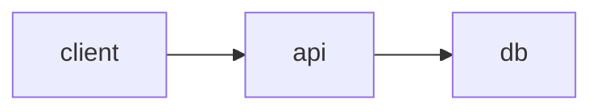

# @mmdx/studio/markdown

Build-time plugins for Markdown pipelines: a rehype plugin and a markdown-it plugin turn each ` ```mermaid ` block into an `<mmdx-viewer>` with a pre-rendered SVG inside, so pages are readable and printable without JavaScript and become interactive when `@mmdx/studio/viewer` loads. The plugins run in Node, have no dependency on unified or markdown-it (they are typed structurally), and are synchronous.

```ts
import { rehypeMmdx, markdownItMmdx, diagramHtml, scriptSafe, type MmdxMarkdownOptions } from '@mmdx/studio/markdown';
```

The page only needs the viewer element in the browser:

```ts
import '@mmdx/studio/viewer'; // defines <mmdx-viewer>
```

## Plugins

### `rehypeMmdx()`

```ts
function rehypeMmdx(opts?: MmdxMarkdownOptions): (tree: HastNode) => void | Promise<void>;
```

A rehype (hast) plugin: `rehypePlugins: [[rehypeMmdx, { theme: 'github-light' }]]`. It replaces every `pre` element whose `code` child has the class `language-mermaid` or `lang-mermaid` with the output of [`diagramHtml()`](#diagramhtml) for the code's text (one trailing newline removed). Other code blocks are left as they are.

The replacement is a hast `raw` node, so the pipeline must let raw HTML through: serialize with `rehype-stringify` and `allowDangerousHtml: true`, or run `rehype-raw` after the plugin to parse it into elements (required for MDX, see [Docusaurus](#docusaurus)). The plugin creates its core context and registers `themes` once, when the plugin is set up. The transformer is synchronous, except when the page's diagrams reference icons that are not loaded yet: then it returns a promise (unified awaits it) and renders once they are.

### `markdownItMmdx()`

```ts
function markdownItMmdx(md: MarkdownIt, opts?: MmdxMarkdownOptions): void;
```

A markdown-it plugin: `md.use(markdownItMmdx, { theme: 'github-light' })`. It wraps the `fence` renderer rule: a fence whose info string starts with the word `mermaid` renders as [`diagramHtml()`](#diagramhtml) of its content (one trailing newline removed); every other fence goes to the previous `fence` rule, or to `<pre><code>…</code></pre>` with the content escaped when there is none. markdown-it renders synchronously, and so does the plugin: the SVG is laid out in Node with the static text measurer, with no browser and no worker. Icons are drawn from what is loaded: with icon packs that load through loaders, call [`preloadIcons()`](#preloadicons) with the pages' sources first and pass the same `ctx`.

Register it after plugins that replace the `fence` rule themselves, so that it sees the ` ```mermaid ` fences first.

## Functions

### `diagramHtml()`

```ts
function diagramHtml(source: string, opts?: MmdxMarkdownOptions, ctx?: CoreContext): string;
```

The HTML for one diagram, the building block of both plugins. `ctx` defaults to `opts.ctx`, else a new `createContext()` per call. `diagramHtml` does not read `opts.themes`: to render with extra themes, pass a context that has them registered (`ctx.themes.register(file)`; see [`@mmdx/studio/core`](/api/core)).

```ts
import { diagramHtml } from '@mmdx/studio/markdown';

const html = diagramHtml('flowchart LR\n  a --> b', { themeDark: 'auto', attrs: { controls: 'zoom fullscreen' } });
```

### `preloadIcons()`

```ts
function preloadIcons(ctx: CoreContext, sources: readonly string[]): Promise<void>;
```

Loads the icons these diagram sources reference into the context's icon registry (the built-in set, Font Awesome look-alikes and the packs of `ctx.icons`), for the synchronous markdown-it plugin.

```js
import { createContext, createIconRegistry } from '@mmdx/studio/core';
import { markdownItMmdx, preloadIcons } from '@mmdx/studio/markdown';

const ctx = createContext({ icons: createIconRegistry([{ name: 'logos', loader: () => import('@iconify-json/logos/icons.json').then((m) => m.default) }]) });
await preloadIcons(ctx, mermaidSourcesOfThePages);
md.use(markdownItMmdx, { ctx });
```

### `scriptSafe()`

```ts
function scriptSafe(s: string): string;
```

Makes text safe inside `<script type="text/mermaid">`: every `</script` (any case) becomes `<\/script`, so the source cannot close the element. Nothing else needs escaping there. The viewer reverses it when it reads the block. `diagramHtml()` applies it to every source.

```ts
scriptSafe('a["</script>"]'); // 'a["<\\/script>"]'
```

## Options

### `MmdxMarkdownOptions`

The options of both plugins and of `diagramHtml()`.

| Option | Type | Default | Description |
| --- | --- | --- | --- |
| `theme` | `string` | none | Theme id for every diagram: the SVG is pre-rendered with it and the viewer gets it as its `theme` attribute. Without it, or with an id the context does not know, the pre-render uses Default Light (`default-light`). |
| `themeDark` | `string` | none | The viewers' `theme-dark` attribute: a theme id, or `auto` for the dark counterpart of the theme. Applies in the browser only; the pre-render always uses `theme`. |
| `prerender` | `boolean` | `true` | Pre-render supported diagrams to SVG. With `false` the element holds only the source and draws in the browser. |
| `themes` | `readonly ThemeFile[]` | none | Extra theme files (for example your site's, or files from `@mmdx/studio/themes/*`) registered into the context when the plugin is set up, before rendering. Read by `rehypeMmdx` and `markdownItMmdx`, not by `diagramHtml`. |
| `attrs` | `Record<string, string>` | none | Viewer attributes added to every element (`controls`, `fit`, …). Names are reduced to letters, digits, `_` and `-`; values are escaped. `theme` and `themeDark` replace `attrs.theme` and `attrs['theme-dark']`; `style` is replaced when the diagram is pre-rendered. |
| `ctx` | `CoreContext` | `createContext()` | The core context to render with (themes, text measurer, icon registry). The plugins create one per plugin instance; `diagramHtml` one per call. Pass one to share a theme registry across calls. |
| `iconPacks` | `readonly IconPack[]` | none | Icon packs over the context's registry (which has the built-in set), as `configure({ iconPacks })` takes them. Read by `rehypeMmdx` and `markdownItMmdx`. See [Icons](/guide/icons#on-the-server). |

See [`<mmdx-viewer>`](/components/viewer) for the attributes `attrs` can set, and [Themes](/guide/themes) for theme ids and files.

```js
import githubLight from '@mmdx/studio/themes/github-light.theme.json' with { type: 'json' };
import githubDark from '@mmdx/studio/themes/github-dark.theme.json' with { type: 'json' };

const options = { theme: 'github-light', themeDark: 'github-dark', themes: [githubLight, githubDark], attrs: { controls: 'zoom fullscreen' } };
```

::: tip
The pre-render only knows the themes in its context. The viewer on the page resolves `theme` and `theme-dark` again in the browser, so the themes must be available there too (see [Themes](/guide/themes)).
:::

## Output

### Emitted HTML

For a supported diagram, the output is one `<mmdx-viewer>` element (on one line; wrapped here) with, in order, the `attrs` attributes, `theme`, `theme-dark`, and a `style` that reserves the diagram's aspect ratio. It contains the pre-rendered SVG, marked with `data-mmdx-ssr`, and the source in an inline `<script type="text/mermaid">`:

```html
<mmdx-viewer controls="zoom fullscreen" theme-dark="auto" style="aspect-ratio:720 / 420">
  <svg xmlns="http://www.w3.org/2000/svg" viewBox="-142 -119 720 420" width="720" height="420"
       data-mmdx-ssr="1" data-mmdx-measure="static"><defs>…</defs>…</svg>
  <script type="text/mermaid">flowchart LR
  a --> b</script>
</mmdx-viewer>
```

`data-mmdx-measure` records how the text was measured (`static` with the default context). The browser does not run the script (its type is not JavaScript) and the SVG shows as a plain picture until the viewer is defined. The viewer then shows the server SVG while it renders the source from the script element itself, and replaces it on its first `mmdx-render`. The source is only ever text: the viewer reads it through `textContent` and never as HTML.

### Unsupported and failing diagrams

Only flowcharts (`flowchart`, `graph`), sequence diagrams (`sequenceDiagram`), ER diagrams (`erDiagram`), mindmaps (`mindmap`) and state diagrams (`stateDiagram`, `stateDiagram-v2`) are pre-rendered. Any other type gets the source only, and the viewer falls back to stock Mermaid in the browser (its `fallback` attribute):

```html
<mmdx-viewer><script type="text/mermaid">pie title Pets
  "Dogs": 386</script></mmdx-viewer>
```

Rendering never throws, so a diagram never fails the build. A source with syntax errors is pre-rendered with what parses, and the viewer reports the errors when it renders it in the browser (`mmdx-error`, see [Events](/api/events)). A diagram over the limits (1 MB of source or 5 000 items) gets no SVG, and the viewer shows it as too large. With `prerender: false`, every diagram is emitted without SVG.

## Usage

### unified

```js
import { unified } from 'unified';
import remarkParse from 'remark-parse';
import remarkRehype from 'remark-rehype';
import rehypeStringify from 'rehype-stringify';
import { rehypeMmdx } from '@mmdx/studio/markdown';

const file = await unified()
  .use(remarkParse)
  .use(remarkRehype)
  .use(rehypeMmdx, { themeDark: 'auto' })
  .use(rehypeStringify, { allowDangerousHtml: true })
  .process(markdown);
const html = String(file);
```

Place `rehypeMmdx` before any rehype syntax highlighter, which would otherwise turn the ` ```mermaid ` code into highlighted spans first.

### Astro

Astro runs its syntax highlighting before your rehype plugins and `rehype-raw` after them, so exclude `mermaid` from highlighting (`excludeLangs`, Astro 5.5 and later) and register the plugin in `astro.config.mjs`:

```js
// astro.config.mjs
import { defineConfig } from 'astro/config';
import { rehypeMmdx } from '@mmdx/studio/markdown';

export default defineConfig({
  markdown: {
    syntaxHighlight: { type: 'shiki', excludeLangs: ['math', 'mermaid'] },
    rehypePlugins: [[rehypeMmdx, { themeDark: 'auto' }]],
  },
});
```

Newer Astro versions deprecate `markdown.rehypePlugins` in favour of `markdown.processor: unified({ rehypePlugins: [...] })` from `@astrojs/markdown-remark`; the plugin entry is the same. Load the viewer once, for example in a layout:

```html
<script>
  import '@mmdx/studio/viewer';
</script>
```

### Docusaurus

Docusaurus compiles every page with MDX, which cannot compile the plugin's `raw` node by itself, so add `rehype-raw` after `rehypeMmdx` and let it pass the MDX nodes through. Code blocks reach rehype as `pre > code.language-mermaid` (Docusaurus renders them with its components later), so `rehypePlugins` is enough and `beforeDefaultRehypePlugins` is not needed. Leave `markdown.mermaid` off: its remark plugin replaces ` ```mermaid ` blocks before rehype runs.

```js
// docusaurus.config.js
import rehypeRaw from 'rehype-raw';
import { rehypeMmdx } from '@mmdx/studio/markdown';

const passThrough = ['mdxFlowExpression', 'mdxJsxFlowElement', 'mdxJsxTextElement', 'mdxTextExpression', 'mdxjsEsm'];

export default {
  presets: [
    [
      'classic',
      {
        docs: {
          rehypePlugins: [
            [rehypeMmdx, { themeDark: 'auto' }],
            [rehypeRaw, { passThrough }],
          ],
        },
      },
    ],
  ],
  clientModules: ['./src/mmdx.js'],
};
```

```js
// src/mmdx.js: define the element in the browser only
import ExecutionEnvironment from '@docusaurus/ExecutionEnvironment';

if (ExecutionEnvironment.canUseDOM) import('@mmdx/studio/viewer');
```

::: warning
This setup is not covered by the library's tests. The diagram becomes React elements, so check that your React version server-renders the inline script's text unescaped (React 19 does).
:::

### VitePress

VitePress uses markdown-it, but compiles each page's HTML as a Vue template, and Vue removes `<script>` elements from templates (and escapes their text in the server render). The `<script type="text/mermaid">` that `markdownItMmdx` emits is therefore lost, and the viewer has no source. In VitePress, emit a component from the `fence` rule instead and create the viewer in the browser, as this site does:

```ts
// .vitepress/config.ts
import { defineConfig } from 'vitepress';

export default defineConfig({
  markdown: {
    config(md) {
      const fence = md.renderer.rules.fence!;
      md.renderer.rules.fence = (tokens, idx, options, env, self) => {
        const t = tokens[idx]!;
        if (t.info.trim().split(/\s+/)[0] !== 'mermaid') return fence(tokens, idx, options, env, self);
        return `<MermaidDiagram code="${encodeURIComponent(t.content.replace(/\n$/, ''))}" />\n`;
      };
    },
  },
  // only needed when pages or components write <mmdx-…> tags in templates
  vue: { template: { compilerOptions: { isCustomElement: (tag) => tag.startsWith('mmdx-') } } },
});
```

```vue
<!-- .vitepress/theme/MermaidDiagram.vue -->
<script setup lang="ts">
import { onMounted, ref } from 'vue';

const props = defineProps<{ code: string }>();
const host = ref<HTMLElement | null>(null);

onMounted(async () => {
  await import('@mmdx/studio/viewer'); // in the browser only: defines <mmdx-viewer>
  const el = document.createElement('mmdx-viewer');
  el.setAttribute('theme-dark', 'auto');
  el.source = decodeURIComponent(props.code);
  host.value?.append(el);
});
</script>

<template><div ref="host" /></template>
```

```ts
// .vitepress/theme/index.ts
import DefaultTheme from 'vitepress/theme';
import MermaidDiagram from './MermaidDiagram.vue';

export default {
  extends: DefaultTheme,
  enhanceApp({ app }) {
    app.component('MermaidDiagram', MermaidDiagram);
  },
};
```

The element is created after the viewer is defined, so `source` reaches its property. The diagrams render in the browser only (no pre-rendered SVG).

### markdown-it

Where markdown-it's output is served as HTML (not compiled as a template), register the plugin on the instance:

```js
import MarkdownIt from 'markdown-it';
import { markdownItMmdx } from '@mmdx/studio/markdown';

const md = new MarkdownIt().use(markdownItMmdx, { attrs: { controls: 'zoom fullscreen' } });
const html = md.render(markdown);
```

A page written as

````md
# Architecture


````

renders the heading as usual and the block as the `<mmdx-viewer>` shown under [Emitted HTML](#emitted-html).

## Run time

### `upgradeMermaidBlocks()`

For Markdown rendered at run time (a CMS, a comment thread), `@mmdx/studio/viewer` exports `upgradeMermaidBlocks(root?, opts?)`. It replaces `pre > code.language-mermaid`, `pre > code.lang-mermaid` and `pre.mermaid` blocks under `root` (default `document`) with viewers, handing each block's `textContent` over as the `source` property, never as HTML, and returns the new elements. Options: `theme`, `themeDark`, `controls`, `fit` and `tag`. See [`upgradeMermaidBlocks()`](/api/configuration#upgrademermaidblocks).

```ts
import { upgradeMermaidBlocks } from '@mmdx/studio/viewer';

upgradeMermaidBlocks(document.querySelector('article')!, { themeDark: 'auto', controls: ['zoom', 'fullscreen'] });
```
