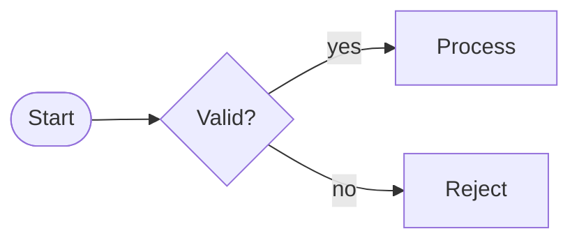

# Playgrounds

Every component on one page, live, with the shipped examples. Nothing here is saved: documents and themes are kept in memory.

For more, open the full app in the [studio](/studio/){target="_self"}, the per-component demo pages ([viewer](/studio/viewer.html){target="_self"}, [editor](/studio/editor.html){target="_self"}, [theme editor](/studio/theme-editor.html){target="_self"}), or every component and UI piece on its own in [Storybook](/storybook/){target="_self"}.

## Viewer

A ` ```mermaid ` block on this portal is a live `<mmdx-viewer>`:



A sequence diagram with its six-version history (press the History button):

<MmdxDemo example="docker-deploy-sequence" history controls="zoom history code fullscreen" />

## Editor

An ER diagram in the editor, with its history:

<MmdxDemo kind="editor" example="atom-schema-er" history />

## Diff

<MmdxDemo kind="diff" sample="flow-few" />

## Theme editor

<MmdxDemo kind="theme-editor" />
