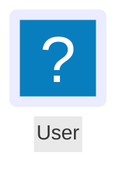

# Flowchart content

mmdx reads, draws and edits the Mermaid flowchart syntax that puts icons, images and styled text into a diagram, and writes it back as Mermaid code, so a file looks the same in stock Mermaid (given the same [icon packs](/guide/icons)). This page lists what is supported and how mmdx draws it; [Shapes](/guide/shapes) covers node shapes and [Icons](/guide/icons) the icon packs.

## Icon nodes



A node with an `icon` key is an icon node, whatever its shape says (as in Mermaid). Its node data can be written with the node or, as Mermaid Chart writes it, in a statement of its own after the label's bracket; both merge into one node.

| Key | Values | Drawn |
|---|---|---|
| `icon` | `pack:name` of a registered pack, `fa:car` style Font Awesome names | The icon; an unknown icon or pack is a "?" placeholder with an `icon.unknown` warning |
| `form` | `square`, `circle`, `rounded`; none | A frame around the icon, painted with the node's fill and stroke (`style`, `classDef`, presets, the theme's `flowchart.nodeShapes.icon`); without it, the bare icon |
| `label` | text | The caption; without a label (neither here nor in a bracket) there is none — not the id, as in Mermaid |
| `pos` | `t`, `b` (default) | The caption above or below the icon |
| `h`, `w` | numbers | The icon is `max(h, w)` square, 48 when neither is given (Mermaid's rule) |

A monochrome icon takes the node's stroke colour from the code (`style n5 stroke:#2962FF`), else the text colour; logos keep their colours. The caption wraps at the icon's width or 200 px (Mermaid's `flowchart.wrappingWidth`), whichever is wider. The node's box — what is selected and laid out — holds the icon and the caption; connectors end on the icon's frame, and on the caption's side past the caption.

## Image nodes

```mermaid
flowchart LR
  n5["Team photo"]
  n5@{ img: "https://example.com/team.png", h: 200, w: 200, pos: "b" }
```

| Key | Values | Drawn |
|---|---|---|
| `img` | an image URL | The picture, when the [image policy](/guide/security#image-policy) accepts its URL (`https:` by default); otherwise a placeholder with an `image.blocked` warning |
| `label`, `pos` | as for icons | The caption |
| `w`, `h` | numbers | The picture's size |
| `constraint` | `on`, `off` | `on` keeps the picture's aspect: its width is `h` × its aspect ratio |

Without `w` and `h` an image is drawn at its picture's own size. The browser knows it only once the picture has loaded: until then the image is 96 × 96, and the viewer and the editor lay the diagram out once more when it arrives. Where the size cannot be known — on the server, in the render worker — the image is 96 × 96 with an `image.size-unknown` note; the editor writes `w` and `h` when it adds an image, so saved diagrams never move. How the picture fills its box — contain (default), cover or stretch — is the layout metadata's `imgFit`, since Mermaid has only the aspect lock.

## Icons in labels

`fa:fa-car Car`, `fab:fa-github` and a token of any registered pack (`azure:computer-vision Vision`, `tabler:bolt Fast`) are drawn as icons in node labels, edge labels and subgraph titles, one em wide on the text's baseline, in the text's colour. A prefix that is no registered pack (and not Font Awesome's) stays text. Stock Mermaid draws only the Font Awesome tokens and shows the others as text; the editor's Properties panel says so for such a token. Without a Font Awesome pack, the `fa:` tokens draw a built-in look-alike (see [Icons](/guide/icons#font-awesome-without-font-awesome)).

## Markdown labels

````mermaid
flowchart LR
  A["`**Bold** and *italic*
  on two lines`"] -->|"`**yes**`"| B
````

A label written as a markdown string (backticks inside the quotes) draws `**bold**`, `__bold__`, `*italic*` and `_italic_`, breaks lines where the string does (a line break in the code, `<br/>`), and wraps by itself at 200 px — or at the node's width when it has one stored. Plain labels stay plain text: their stars are characters, as in Mermaid 11.13 and later. In the frontmatter, `markdownAutoWrap: false` turns the wrapping off and `flowchart.wrappingWidth` sets its width.

In the editor, a markdown label is edited with its `**` and `*` as typed: the Bold and Italic buttons above the text box (`⌘B`, `⌘I`) wrap the selected words, and on a plain label **Make rich text** turns it into a markdown string. The floating toolbar's Bold still styles a whole plain label (in the layout metadata).

## Links

| Syntax | Behaviour |
|---|---|
| `A ~~~ B` | An invisible link: it places its nodes and is not drawn or selectable; edit it in the code. The outline lists it |
| `A ---> B`, `A -..-> B`, `A -- text ---> B` | The link's length in ranks, as Mermaid counts it: the dashes, equals or dots beyond the shortest form (`-->`, `---` and `-.->` are 1); a labelled link counts its closing part |
| `A e1@--> B` | An edge id. The edge's layout metadata is kept under it (`%%@ edge e1`); metadata written under `A->B` before the id was given still applies, and moves to the id on the next edit |
| `e1@{ animate: true }`, `animation: fast \| slow` | Dashes flowing along the line in the viewer and the editor; still dashes in exported SVG and PNG. The motion stops with the system's reduced-motion setting and with the **Animate edges** view setting |
| `e1@{ curve: linear }` | The line's curve: `linear` is straight, `step`, `stepBefore` and `stepAfter` orthogonal, the others (`basis`, `cardinal`, `monotoneX`…) curved; routing set in the layout metadata wins |
| `linkStyle 0 stroke:red,color:blue` | Line colour and, with `color`, the label's colour |
| `linkStyle 0 interpolate basis`, `linkStyle default interpolate linear` | The curve of one link or of all of them |

The frontmatter's `flowchart.curve` (or `%%{init: {"flowchart": {"curve": …}}}%%`) is the diagram's default curve.

## Classes and styles

- `classDef default …` styles every node, under the node's own classes.
- `class a,b c1,c2` gives several items several classes, applied in order; `A:::c1:::c2` too (stock Mermaid 11 reads one `:::` class, so mmdx notes it).
- Classes on a subgraph (`class s1 hot`) style its frame.
- `stroke-dasharray: none` in a `classDef` or `style` draws a solid line over a dashed preset.

## Interaction, title and accessibility

| Syntax | Behaviour |
|---|---|
| `click A "https://…" "Tooltip"` | A link (checked by the link policy) and a tooltip shown on hover; `click A callback "Tooltip"` shows the tooltip and runs nothing |
| `title: …` in the frontmatter | Drawn above the diagram, as a sequence diagram's title. A `title …` statement is drawn too, but stock Mermaid fails on it in a flowchart: the code panel offers a fix that moves it to the frontmatter |
| `accTitle: …`, `accDescr: …`, `accDescr { … }` | The SVG's `<title>` and `<desc>` (exports and server-side renders), and the viewer's accessible name and description instead of the generated "Flowchart: 12 nodes…" |
| `subgraph X` written twice | One subgraph with the nodes of both (Mermaid 12.1); its title is the first one written |

## Settings in the code

The frontmatter's `config:` and `%%{init}%%` are kept on round-trip and ignored for the theme and the look, by design: the theme is mmdx's. A few settings change what the content means and are read: `flowchart.curve`, `htmlLabels` (mmdx always draws SVG text), `markdownAutoWrap` and `flowchart.wrappingWidth`. Mermaid Chart's `layout: fixed` is kept and ignored — positions come from the layout metadata once a diagram is moved in mmdx, and from the automatic layout before.

## Files from Mermaid Chart

Files written by Mermaid Chart's editor open as they are: node data in separate statements merges into the nodes, whitespace inside `@{…}` does not matter, a `@{ img … }` without a `label` takes the bracket's, `style` colours an icon node's frame, and nothing changes in the file until you edit something. mmdx writes new icon and image nodes the same way (see the [editor](/components/editor#insert-dock)).
