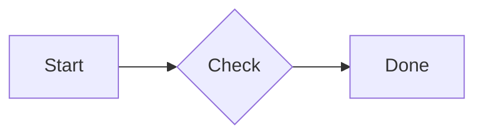

# Getting started

Install `@mmdx/studio`, import the entry of the component you need, and put its element on the page. This page shows the four common starts: a viewer, an editor, a diff and server-side rendering.

## Install

::: code-group

```bash [npm]
npm install @mmdx/studio
```

```bash [pnpm]
pnpm add @mmdx/studio
```

```bash [yarn]
yarn add @mmdx/studio
```

:::

`mermaid` (≥ 10) is an optional peer dependency. Install it only for diagram types mmdx does not draw itself (anything but flowchart, sequence, ER, mindmap and state diagrams) and for the editor's "Plain Mermaid" preview; it is loaded lazily, on first use (in Node and with an import map it is found on its own):

::: code-group

```bash [npm]
npm install mermaid
```

```bash [pnpm]
pnpm add mermaid
```

```bash [yarn]
yarn add mermaid
```

:::

In a bundled app, hand it over once, so your bundler includes it (mmdx never imports it by name, so builds without it work too):

```ts
import { configure } from '@mmdx/studio/viewer';
configure({ mermaid: () => import('mermaid') });
```

::: tip ESM only
The package is ESM only and targets ES2022. It has no runtime dependencies. Use it through a bundler (Vite, Rollup, esbuild, webpack) or any setup that resolves bare module specifiers. `@mmdx/studio/core` also runs in Node 18 or newer.
:::

## Show a diagram

Import `@mmdx/studio/viewer` once; it registers `<mmdx-viewer>`. Give the viewer its diagram inline, as a property, or as a URL:

```html
<script type="module">
  import '@mmdx/studio/viewer';
</script>

<mmdx-viewer controls="zoom layers fullscreen export">
  <script type="text/mermaid">
    flowchart LR
      a[Start] --> b{Check} --> c[Done]
  </script>
</mmdx-viewer>

<!-- or load a file -->
<mmdx-viewer src="/diagrams/architecture.mmdx" theme-dark="auto"></mmdx-viewer>
```

The result, live (hover it to see the controls):



The viewer renders lazily when it scrolls near, sizes itself to its width (`fit="width"`) and keeps page scroll free: only ⌘ / Ctrl + wheel zooms. Its `controls` attribute picks the chrome: any of `zoom layers pen code history export theme fullscreen`, or `none`. A full diagram with layers, the pen, the code view and its history:

<MmdxDemo example="production-microservices" history controls="zoom layers pen code history export theme fullscreen" />

See [`<mmdx-viewer>`](/components/viewer) for every attribute, property, event and method.

## Edit a diagram

Import `@mmdx/studio/editor` and give the editor a `DocumentAdapter` that loads and saves the document:

```ts
import '@mmdx/studio/editor';
import { httpDocumentAdapter } from '@mmdx/studio/adapters';

const editor = document.querySelector('mmdx-editor')!;
editor.adapter = httpDocumentAdapter('/api/diagrams/architecture.mmdx'); // load + save with If-Match conflict detection
editor.addEventListener('mmdx-dirty', (e) => setUnsaved(e.detail.dirty));
```

```html
<mmdx-editor guard-unload style="height: 640px"></mmdx-editor>
```

Without an adapter, set `editor.value = source` and read changes from the `mmdx-change` event:

```ts
editor.value = source;
editor.addEventListener('mmdx-change', (e) => save(e.detail.source));
```

Give the editor a height: it fills its box. The editor below runs on an in-memory document with the example's history:

<MmdxDemo kind="editor" example="atom-schema-er" history />

[Saving documents](/guide/documents) covers adapters, conflicts, autosave and drafts; [`<mmdx-editor>`](/components/editor) is the full reference.

## Review a change

Import `@mmdx/studio/diff` and give `<mmdx-diff>` two versions, as URLs or sources:

```html
<script type="module">
  import '@mmdx/studio/diff';
</script>

<mmdx-diff before="/api/files/arch.mmdx?ref=main" after="/api/files/arch.mmdx?ref=feature-x" style="height: 720px"></mmdx-diff>
```

Or give it the whole history of a diagram (newest first) and let the reviewer pick any two versions:

```ts
import { httpHistoryAdapter } from '@mmdx/studio/diff';

const diff = document.querySelector('mmdx-diff')!;
diff.history = httpHistoryAdapter('/api/diagrams/arch/versions'); // or a list: [{ id, message, author, date, source }]
```

<MmdxDemo kind="diff" sample="flow-few" />

See [Version history](/guide/history) and [`<mmdx-diff>`](/components/diff).

## Render on the server or at build time

`@mmdx/studio/core` has no DOM dependency. `renderToSvg` turns a source into a standalone SVG string:

```ts
import { renderToSvg } from '@mmdx/studio/core';

const svg = await renderToSvg(source, { theme: 'default-dark' }); // a standalone SVG string, no DOM needed
```

A diff renders the same way, for example in a CI job that comments on merge requests touching `*.mmdx`:

```ts
import { diffDiagrams, diffReport, renderDiffToSvg } from '@mmdx/studio/core';

const svg = await renderDiffToSvg(before, after, { view: 'merged', ignore: { layout: true } });
const md = diffReport(diffDiagrams(before, after), { format: 'markdown', before: { id: baseSha }, after: { id: headSha } });
```

See [Server-side rendering](/guide/ssr) and [Reviewing changes in CI](/guide/ci).

## The complete app

`<mmdx-studio>` is the whole app — editor, examples, file open and theme editor — in one element, as on the [demo](/studio/){target="_self"}:

```html
<script type="module">
  import '@mmdx/studio';
</script>

<mmdx-studio examples="./examples/index.json" themes="./themes/index.json" persist="local"></mmdx-studio>
```

See [`<mmdx-studio>`](/components/studio).

## Next steps

- [The `.mmdx` format](/guide/mmdx-format) — what the metadata lines hold.
- [Themes](/guide/themes) and [Configuration](/guide/configuration) — theme files, `configure()`, i18n and the link policy.
- [Frameworks](/guide/frameworks) — React, Vue, Angular and Svelte.
- [Markdown and docs sites](/guide/markdown) — turn ` ```mermaid ` blocks into viewers.
- [Playgrounds](/components/playgrounds) — every component live on one page.
