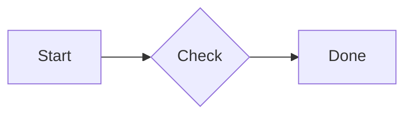
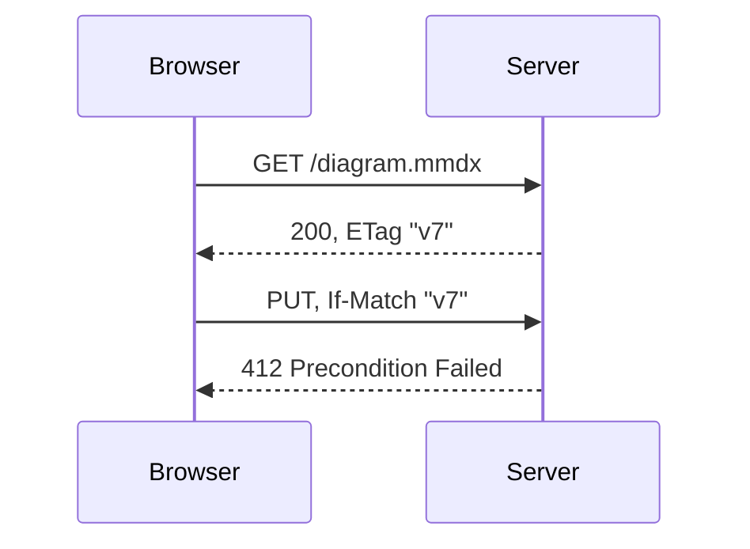

# Markdown and docs sites

`@mmdx/studio/markdown` turns ` ```mermaid ` code blocks into `<mmdx-viewer>` elements at build time, with a pre-rendered SVG inside, so pages are readable and printable without JavaScript and become interactive when `@mmdx/studio/viewer` loads. For pages rendered at run time (a CMS, a wiki), `upgradeMermaidBlocks()` does the same in the browser.

## What a block becomes

````md

````

becomes

```html
<mmdx-viewer style="aspect-ratio:<width> / <height>">
  <svg data-mmdx-ssr="1" …>…</svg>
  <script type="text/mermaid">flowchart LR
  a[Start] --> b{Check} --> c[Done]</script>
</mmdx-viewer>
```

The SVG shows until the viewer has rendered the source itself. A block may hold a `.mmdx` source with `%%@` lines; the layout and styles apply. A diagram type mmdx does not draw gets the source only, and the viewer falls back to stock Mermaid (when `mermaid` is installed). Pages need the viewer on the client:

```ts
import '@mmdx/studio/viewer';
```

This portal turns every ` ```mermaid ` block into a live viewer too (in the browser; see [VitePress](#vitepress)), like this one:



## Options

Both plugins and `diagramHtml` take the same options:

| Option | Default | Meaning |
|---|---|---|
| `theme` | Default Light | The theme every diagram is pre-rendered with, also set as the viewers' `theme` attribute |
| `themeDark` | — | The viewers' `theme-dark` attribute (`auto`: the dark counterpart of `theme`) |
| `attrs` | — | Viewer attributes added to every element: `{ controls: 'zoom fullscreen', fit: 'contain' }` |
| `prerender` | `true` | Pre-render supported diagrams to SVG; `false` emits the source only |
| `themes` | — | Extra theme files (`ThemeFile[]`) registered before rendering, for a `theme` that is not built in |
| `ctx` | `createContext()` | The `CoreContext` to render with |

```ts
import githubLight from '@mmdx/studio/themes/github-light.theme.json' with { type: 'json' };
import githubDark from '@mmdx/studio/themes/github-dark.theme.json' with { type: 'json' };

const options = { theme: 'github-light', themeDark: 'auto', themes: [githubLight, githubDark], attrs: { controls: 'zoom fullscreen' } };
```

The viewers in the browser need the same themes: register them there too (`registerThemes`) or give them a [theme source](/guide/themes#theme-sources).

## rehype (unified)

`rehypeMmdx(options)` replaces every `pre > code.language-mermaid` (or `lang-mermaid`) in the HTML tree:

```ts
import { unified } from 'unified';
import remarkParse from 'remark-parse';
import remarkRehype from 'remark-rehype';
import rehypeStringify from 'rehype-stringify';
import { rehypeMmdx } from '@mmdx/studio/markdown';

const file = await unified()
  .use(remarkParse)
  .use(remarkRehype)
  .use(rehypeMmdx, { themeDark: 'auto' })
  .use(rehypeStringify, { allowDangerousHtml: true })
  .process(markdown);
```

The plugin inserts each viewer as a `raw` HTML node, so the stringifier must allow raw HTML (`allowDangerousHtml: true`). It has no dependency on unified; it works on the tree structurally.

## markdown-it

`markdownItMmdx(md, options)` replaces the fence renderer for blocks whose language is `mermaid`; other fences go to the previous renderer:

```ts
import MarkdownIt from 'markdown-it';
import { markdownItMmdx } from '@mmdx/studio/markdown';

const md = new MarkdownIt().use(markdownItMmdx, { attrs: { controls: 'zoom fullscreen' } });
const html = md.render(markdown);
```

## diagramHtml

`diagramHtml(source, options?, ctx?)` is the markup of one diagram, for template engines and static site generators without Markdown:

```ts
import { diagramHtml } from '@mmdx/studio/markdown';

const html = diagramHtml(source, { attrs: { controls: 'zoom fullscreen' } });
```

`scriptSafe(text)` is the escaping it uses for the inline script: only `</script` needs breaking, and the viewer reverses it.

## VitePress

VitePress compiles Markdown into Vue templates, and Vue drops `<script>` tags from templates, so the inline source of `markdownItMmdx`'s output does not reach the page. This portal does it the other way round: a fence rule passes the code to a Vue component that creates the viewer in the browser and sets its `source` property.

```ts
// .vitepress/config.ts
import { defineConfig } from 'vitepress';

export default defineConfig({
  markdown: {
    config(md) {
      const fence = md.renderer.rules.fence!;
      md.renderer.rules.fence = (tokens, idx, options, env, self) => {
        const t = tokens[idx]!;
        if (t.info.trim().split(/\s+/)[0] !== 'mermaid') return fence(tokens, idx, options, env, self);
        return `<MermaidDiagram code="${encodeURIComponent(t.content)}" />\n`;
      };
    },
  },
  vue: { template: { compilerOptions: { isCustomElement: (tag) => tag.startsWith('mmdx-') } } },
});
```

```vue
<!-- .vitepress/theme/MermaidDiagram.vue, registered in enhanceApp: app.component('MermaidDiagram', MermaidDiagram) -->
<script setup lang="ts">
import { onMounted, ref } from 'vue';

const props = defineProps<{ code: string }>();
const host = ref<HTMLElement | null>(null);

onMounted(async () => {
  await import('@mmdx/studio/viewer'); // in the browser only
  const el = document.createElement('mmdx-viewer');
  el.source = decodeURIComponent(props.code);
  el.setAttribute('controls', 'zoom fullscreen');
  host.value?.replaceChildren(el);
});
</script>

<template><div ref="host" /></template>
```

VitePress marks dark mode with a `dark` class on `<html>`; the viewers' `ui="auto"` follows `data-theme` on `<html>`. Mirror it in a layout component: `document.documentElement.dataset.theme = isDark.value ? 'dark' : 'light'` (with `useData()`).

## Astro

```js
// astro.config.mjs
import { defineConfig } from 'astro/config';
import { rehypeMmdx } from '@mmdx/studio/markdown';

export default defineConfig({
  markdown: {
    rehypePlugins: [[rehypeMmdx, { themeDark: 'auto', attrs: { controls: 'zoom fullscreen' } }]],
  },
});
```

Load the viewer on the pages that show diagrams, for example in the layout:

```html
<script>
  import '@mmdx/studio/viewer';
</script>
```

::: warning Syntax highlighting
A highlighter that runs before the plugin rewrites the code block, and the plugin no longer finds `pre > code.language-mermaid`. Exclude `mermaid` from highlighting (or turn it off) if the blocks stay code.
:::

## Docusaurus

Add the plugin to the docs (and blog) options of the classic preset, and load the viewer on the client with a client module:

```js
// docusaurus.config.js
import { rehypeMmdx } from '@mmdx/studio/markdown';

export default {
  presets: [['classic', { docs: { rehypePlugins: [[rehypeMmdx, { themeDark: 'auto' }]] } }]],
  clientModules: ['./src/mmdx-client.js'], // import '@mmdx/studio/viewer';
};
```

::: warning MDX
Docusaurus compiles Markdown with MDX, which turns the tree into JSX and does not accept raw HTML nodes. Turn the plugin's output into elements with `rehype-raw` after it (passing MDX's own node types through), or skip the build-time plugin and call `upgradeMermaidBlocks()` in the client module instead (below). Do not turn on Docusaurus's own Mermaid support together with the plugin: it renders the same blocks.
:::

## Run-time upgrade

For pages rendered elsewhere — a CMS, a wiki, Markdown rendered in the browser — `upgradeMermaidBlocks(root?, options?)` from `@mmdx/studio/viewer` replaces the Mermaid code blocks under `root` (default `document`) with viewers:

```ts
import { upgradeMermaidBlocks } from '@mmdx/studio/viewer';

const viewers = upgradeMermaidBlocks(document.querySelector('article')!, { controls: ['zoom', 'fullscreen'], themeDark: 'auto' });
```

It finds `pre > code.language-mermaid`, `pre > code.lang-mermaid` and `pre.mermaid`, reads the code through `textContent`, and hands it to the viewer as its `source` property — never as HTML. Options: `theme`, `themeDark`, `controls` (an array; empty means `none`), `fit`, and `tag` (another element name). It returns the new elements. Call it again after the page renders new content (a client-side route change).

See [`@mmdx/studio/markdown`](/api/markdown) for the API reference.
