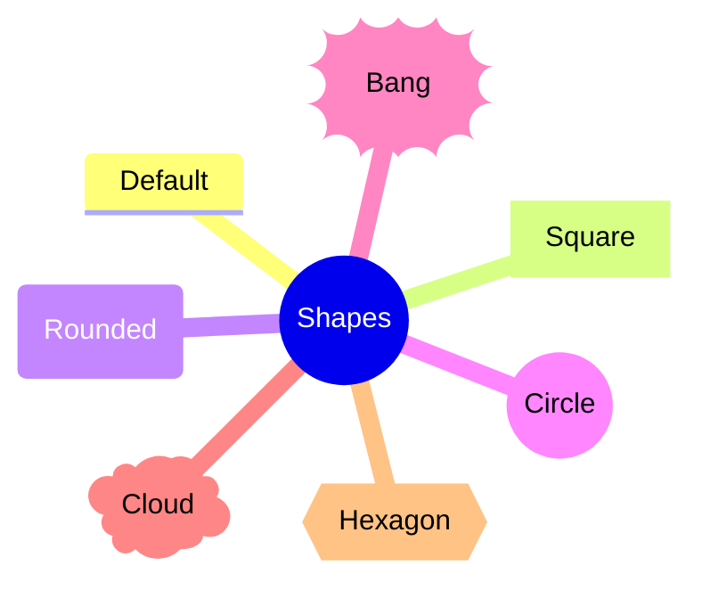

# Mindmaps

mmdx reads, draws and edits Mermaid mindmaps, and writes them back as Mermaid code, so a file still opens in stock Mermaid. It draws them with a layout of its own — a tidy tree with the branches on both sides of the root — that stays put while the map is edited. This page lists the syntax mmdx reads, how it draws it, and how the editor changes it; [the editor page](/components/editor#mindmaps) has the keys in short.

<MmdxDemo example="product-mindmap" history controls="zoom code history export theme" />

## Syntax

```mmdx
mindmap
  root((Product launch))
    Goals
      Grow active users
      **Faster** onboarding
    research[User research]
      Interviews
      ::icon(fa fa-comments)
    risks{{Risks}}
      Scope creep
      :::urgent
```

A mindmap's structure is its indentation: each line is a node, and its parent is the nearest earlier node with a smaller indentation. mmdx reproduces Mermaid's own lexer (11.17 and 12.2), so a file means the same tree in both.

| Syntax | Reads |
|---|---|
| `mindmap` | The header, in any case; frontmatter and `%%{init}%%` may come before it. Without it: `mm.header` (error) |
| Indentation | Counted in characters, a tab being one, as Mermaid counts it. The first node is the root; a later node at the root's indentation or less is an error in Mermaid ("There can be only one root"): mmdx reports `mm.second-root` and draws it under the root |
| `Topic` | A bare line: a node of the default shape whose text is the line |
| `id[text]`, `[text]` | A node with an id (or without one) and its text in the shape's delimiters (see [Shapes](#shapes)) |
| `id["a (b) [c]"]` | Quoted text, which may hold brackets |
| ``id["`**bold** *italic*`"]`` | A markdown string, which may run over several lines |
| `::icon(fa fa-book)` | On the line after a node: the node's icon (see [Icons](#icons)) |
| `:::urgent done` | On the line after a node: its classes (see [Classes and presets](#classes-and-presets)) |
| `%% comment` | A comment, at the start of a line only: a `%%` later in a line is text, as in Mermaid |
| `<br/>`, emoji | A line break; emoji as text |

A line Mermaid cannot read (an unclosed bracket, text that needs quotes) is reported as `mm.syntax` (error) and skipped, so the rest of the map still draws. `::icon` or `:::` before the first node is `mm.dangling` (error: Mermaid fails on it). A `classDef …` or `style …` line is drawn as a node, as Mermaid draws it, with an `mm.classdef` warning: a mindmap has neither.

The frontmatter's `config.mindmap` settings that change the content are read: `colorBy` (`branch` or `depth`, Mermaid 12.2; see [Colours](#colours)) and `maxNodeWidth`, where labels wrap (200 by default). `layout` and `padding` are ignored, since mmdx lays the map out itself.

## Shapes



| Syntax | Shape |
|---|---|
| `text` (no delimiters) | Default: the label over a 3 px underline in its branch colour (Mermaid's default node) |
| `id[text]` | Square |
| `id(text)` | Rounded square |
| `id((text))` | Circle |
| `id))text((` | Bang |
| `id)text(` | Cloud |
| <code v-pre>id{{text}}</code> | Hexagon |

Mermaid's lexer quirks are kept: `id(text(` is a cloud, and `(-text-)` or `(-"text"-)` is the default shape (the form the editor writes for a default node whose text cannot stand alone on its line). The root without delimiters is drawn in the theme's root shape, rounded in the built-in themes, as Mermaid draws it. Shaped nodes are filled with their branch colour; the root has its own look. A shape of the [catalogue](/guide/shapes) that Mermaid's mindmap has no delimiters for can be given in the layout metadata (`shape`); mmdx draws it, stock Mermaid does not.

## Ids

A node's id is what it is written with (`research[User research]` is `research`) when no other node has that id. Bare lines, nodes in brackets without an id and repeated ids have none of their own, and get a positional id: `mm<k>`, k being the node's place among all nodes in code order (`mm3` is the third node), or `mm<k>_2` when a written id already takes it. Metadata is stored under these ids (`%%@ node research {…}`, `%%@ node mm3 {…}`); the editor keeps it with its node when lines are added, moved or deleted above it (see [The .mmdx format → Ids](/guide/mmdx-format#ids)). Give a node an id to tie its metadata to it for good.

## Labels and markdown

Mermaid reads every mindmap label as markdown, and so does mmdx: `**bold**`, `__bold__`, `*italic*` and `_italic_` are drawn as such in plain and quoted labels too, and a markdown string (`` "`…`" ``) also breaks lines where it does. Labels wrap at `maxNodeWidth` (200 px unless the frontmatter sets it). `<u>…</u>` and `<s>…</s>` underline and strike, as in flowchart labels. In the editor, the toolbar's text format menu (`⌘B`, `⌘I`, `⌘U`, `⇧⌘X`) works as for [flowchart labels](/guide/flowchart#markdown-labels).

## Icons

There are two ways to give a node an icon:

- **A label token** at the start of the text — `fa:fa-book Reading`, `tabler:bulb Ideas` — drawn in the label, one em wide. Stock Mermaid draws the Font Awesome tokens too, and shows other packs' tokens as text.
- **`::icon(…)`** on the line after the node, in a CSS class form: `::icon(fa fa-book)`, `::icon(fa-solid fa-car)`, `::icon(mdi mdi-skull-outline)`. mmdx draws it above the label, resolved through the [icon packs](/guide/icons) (`fa fa-book` is `fa:book`). Stock Mermaid 11.17 and 12.2 read `::icon()` but do not draw it, although Mermaid's documentation shows it; mmdx reports it as `mm.icon-not-drawn` (info).

Either icon is placed by metadata `iconPos`: a label token is drawn inline before the text by default (`l`), an `::icon()` above the label (`t`); `t` puts either above the text and `b` below it, at 1.75 em. `iconSize` sizes it (a token with a size of its own is drawn left of the text block) and `iconColor` colours it (a colour or palette reference; the text colour otherwise).

The editor has no Icon button for nodes: an icon is the source of an image node (below), chosen in the image tool's **Icon** tab. Icons already written (`::icon()` lines, label tokens) are still drawn.

## Classes and presets

`:::urgent` on the line after a node gives it classes. Stock Mermaid styles them only with CSS of the page it runs on; mmdx draws a class that names a preset with that preset — of the theme's `mindmap.nodePresets` (the built-in themes have `idea`, `urgent`, `done`, `question`, `muted` and `plain`) or of the diagram's own (`%%@ style.node <name>`). A preset chosen in the editor goes into the metadata (`preset`). A default node with a fill of its own (from a preset or its style) draws a box behind its underlined label.

## Colours

```mmdx
---
config:
  mindmap:
    colorBy: depth
---
mindmap
  root(Cell biology)
```

Each child of the root starts a branch colour that its whole subtree shares, as in Mermaid (the i-th child takes section i % 11 of the theme's twelve `mindmap.sections`). With `colorBy: depth` each depth takes a colour instead. A node's metadata `section` (0–11) gives the node and its subtree another of the theme's colours. Branch lines and underlines take the section's `color`, shaped nodes its `fill` and `text`; presets and a node's own style go over them. The colours are palette references, so the map recolours with the theme ([Theme file → mindmap](/api/theme-file#mindmap)).

In the editor, the page's **Colours** setting (by branch, by depth) writes `colorBy: depth` into the frontmatter, and removes it again for by branch, Mermaid's default.

## Layout

mmdx lays a mindmap out as a tidy tree: every subtree is placed next to its siblings as close as its outline allows, never overlapping them, the parent midway along its children. The layout depends only on the tree and the node sizes, so it is the same on every render, and an edit moves only the branch it touches and those around it.

| `mindLayout` | Layout |
|---|---|
| `both` (default) | The root in the middle, the first-level branches split between its right and left sides so that the two sides are about as tall; in code order, the first ones on the right, top to bottom, then the left side from bottom to top (clockwise) |
| `right` | Every branch to the right of the root |
| `down` | The tree from top to bottom, for wide, shallow maps |

`mindLayout` is a page setting: `%%@ canvas {"mindLayout":"right"}`, the page presets `both`, `right` and `down` of every built-in theme, or the editor's page Properties (Mindmap → Layout). Three node keys adjust the result:

| Key | Effect |
|---|---|
| `side` | `"l"` or `"r"`: the side of the root a first-level branch goes on, whatever the split. The editor writes it when a branch is dragged across the root |
| `dx`, `dy` | The node and its subtree moved by this much from where the layout puts them |
| `collapsed` | `true`: the subtree is folded and takes no space; a +N badge on the node counts the hidden nodes |

Branches are curves from the parent's outer edge to the child's inner edge (the end of a default node's underline), 11, 8, 5 and 3 px wide from the first level down (the theme's `mindmap.branch.width` scales them).

## Folding

A folded branch (metadata `collapsed: true`) hides its subtree and shows a +N badge. The editor folds and unfolds with `Space`, the chevron beside the selected node, or a click on the badge; the state is saved with the diagram, so the viewer, exports and the diff show the map folded the same way. The viewer does not fold or unfold branches itself.

## Images

Mermaid's mindmap has no image syntax, so a node's picture is metadata, drawn as a flowchart [image node](/guide/flowchart): the picture is the item, its text the caption — `%%@ node mm4 {"img":"https://example.com/team.png","w":200,"h":200,"pos":"b","constraint":"on"}`, with the flowchart's keys: `w` × `h` the picture's box, `constraint: "on"` its aspect kept, `pos` the caption below (`b`) or above (`t`), `imgFit` how it fills the box (`imgW` / `imgH` still size it where `w` / `h` are not written). Instead of a picture, `icon` (with `form`, its frame) shows an icon. An empty `img` (`""`) is a picture not chosen yet: the placeholder. The URL goes through the [image policy](/guide/security#image-policy); a refused one is a placeholder with an `image.blocked` warning. The editor's Image tool adds one, and **Change image** changes it, as in a flowchart.

## Editing


A new mindmap starts from `mindmap` and `root((Topic))` (the Mindmap card of the editor's "Start a diagram" chooser, the studio's New menu, `starterSource('mindmap')`). The editor works on the tree like an outline editor:

- `Tab` adds a child, `Enter` a sibling (on the root: a child), both opening the new node's text; `⇧Tab` or `⌥←` moves a node out of its parent, `⌥→` under the sibling above it; `⌥↑` / `⌥↓` (or `⌘[` / `⌘]`) trade it with a sibling; the arrow keys walk the tree.
- `F2` or a double-click edits a node's text, kept in its delimiters and quoted when it needs to be.
- `Del` deletes a node with its subtree; `⇧Del` deletes the node only and lifts its children (the root only when it has one child).
- The `+` handle on the selected node's outer side adds a child; dragging a node onto another re-parents it, between siblings reorders it, and across the root switches its side; Alt-drag drops a copy.
- `⌘C` / `⌘V` copy branches and paste them under the selected node; `⌘D` duplicates them. Pasting indented text, a Markdown list or a Mermaid mindmap onto a node adds it as a subtree.
- The Shapes menu has the seven Mermaid shapes; the Text, Icons and Image tools add nodes too. New nodes become children of the selected node, else of the node nearest where they are dropped, else of the root.

Every change is a rewrite of the indented lines, re-indented in the file's own step. [The editor page](/components/editor#mindmaps) lists every gesture.

<MmdxDemo kind="editor" example="study-notes" />

## History and diff

The [diff](/components/diff) and History match a mindmap's nodes across versions by written id, then by their place in the tree (the path of labels and the rank among siblings with the same label), then by label and parent, then by label alone — so a branch moved elsewhere is one node that moved. A new parent or a new place among the siblings is a layout change, as are `side`, `dx` / `dy` and `collapsed`; the label, the shape, the `::icon()` and the picture are content; classes and metadata looks are style; switching colours by branch or by depth is a change of the page. The merged picture keeps removed nodes under their old parent at their old place and marks renamed labels word by word.

## What stock Mermaid shows

The same file opens in stock Mermaid (GitHub, GitLab, Mermaid Live) with the same tree, labels, shapes and Font Awesome tokens, but laid out by Mermaid's own force-directed layout, which places the branches differently and can rearrange them when the map changes. mmdx's tidy tree is deliberate: a map edited in mmdx keeps its shape. Besides the layout, stock Mermaid differs in that it:

- does not draw `::icon()` (mmdx does; write icons as label tokens to see them in both);
- styles `:::` classes only with the page's CSS (mmdx draws the presets of those names);
- shows icon tokens of packs other than Font Awesome as text;
- knows nothing of the `%%@` metadata: folding, sides, nudges, section colours, pictures, presets and catalogue shapes there are mmdx's.

The editor's **Plain Mermaid** preview shows what stock Mermaid draws.
