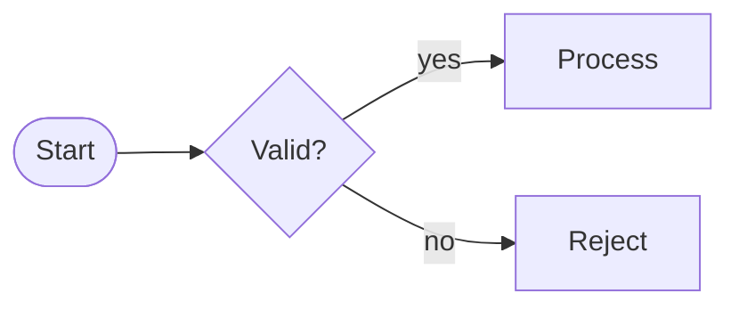

# The .mmdx format

A `.mmdx` file is a Mermaid diagram followed by `%%@` lines, one per placed or styled item. Mermaid treats every `%%` line as a comment, so the file stays valid Mermaid for every renderer; Mermaid Studio reads the lines to draw the diagram exactly as it was arranged.

## Anatomy of a file

The same diagram, as code and live:

```mmdx
flowchart LR
  a([Start]) --> b{Valid?}
  b -->|yes| c[Process]:::core
  b -->|no| d[Reject]

%% ---- diagram-studio layout (safe to keep: Mermaid ignores %% comments) ----
%%@ canvas {"v":1,"routing":"orthogonal"}
%%@ style.node warn {"fill":"@pale-rose","stroke":"@red"}
%%@ node a {"x":90,"y":120,"w":120,"h":52}
%%@ node b {"x":290,"y":120,"w":150,"h":96}
%%@ node c {"x":520,"y":50,"w":150,"h":56}
%%@ node d {"x":520,"y":190,"w":150,"h":56,"preset":"warn"}
%%@ edge b->d {"color":"@red"}
```



- The Mermaid part holds the structure: nodes, labels, shapes, edges and the `:::core` class.
- The header comment (`%% ---- diagram-studio layout … ----`) separates the two parts. The writer adds it; a file without it reads the same.
- `canvas` carries the format version (`"v":1`) and the page settings, here the default routing of connectors.
- `style.node warn` defines a preset local to this diagram; node `d` uses it.
- Each `node` line places one node; `x` and `y` are the centre of the box, `w` and `h` its size. Colours are palette references (`@red`), resolved by the theme.
- `:::core` names a preset of the theme, so `c` takes the theme's `core` style.

The viewer's code panel (`controls="code"`, a button in its tool dock) shows the Mermaid code without the metadata and styles.

## Line syntax

Each metadata line is:

```mmdx
%%@ <kind> <id> <JSON object>
```

- `kind` is one of the kinds below, or `style.<kind>` for a preset.
- `id` is the item's id. Ids with whitespace or `%` are URI-encoded so the line stays three parts.
- The JSON part must be an object. Every value is validated when the line is read: an invalid value is dropped with a diagnostic, the rest of the line is kept.
- Lines this version does not understand (an unknown kind, invalid JSON, a bad id) are kept verbatim and written back after the known lines, so data from a newer writer survives a round-trip through an older component.
- Plain `%%` comments in the Mermaid part are left alone.

## Line kinds

| Line | Holds |
|---|---|
| `%%@ canvas {…}` | Format version, page size and proportions, page background, routing default, page preset |
| `%%@ node <id>`, `group <id>`, `edge <from>-><to>` | Flowchart item position, size, preset and style overrides |
| `%%@ participant <id>`, `message m1`, `note n1`, `block b1`, `box box1`, `activation B:1` | Sequence diagram items |
| `%%@ entity <name>`, `rel <A>--<B>` | ER tables and relationships |
| `%%@ style.<kind> <name> {…}` | A style preset defined in this diagram (`style.node`, `style.edge`, `style.entity`, …) |
| `%%@ layer <id> {"name":…,"hidden":…}` | A user-defined layer |

The keys an item line may carry:

| Key | Meaning |
|---|---|
| `x`, `y`, `w`, `h` | Position (centre) and size |
| `preset` | A preset of the theme or of the diagram (`style.<kind>`) |
| `layer` | The layer the item belongs to |
| `locked` | The item is locked on the canvas |
| `link` | A link opened from the item (checked by the [link policy](/guide/security#link-policy)) |
| `points`, `fromSide`, `toSide`, `fromAt`, `toAt`, `labelDx`, `labelDy` | Connector bend points, ports and label offset |
| `dy` | Vertical shift of sequence items |
| `attrs` | ER attribute highlights |
| Style keys | `fill`, `stroke`, `strokeWidth`, `radius`, `shape`, `fontSize`, `color`, `arrow`, `routing`, … (style overrides) |

Unknown keys are kept on round-trip. A sequence diagram's real examples look like this:

```mmdx
%%@ canvas {"v":1,"blockSpan":"touched"}
%%@ participant env {"h":90,"x":436,"w":250,"wrap":true}
%%@ message m1 {"labelSize":22}
%%@ block b3 {"labelSize":32,"dy":15}
```

and an ER diagram's:

```mmdx
%%@ canvas {"v":1,"routing":"orthogonal"}
%%@ style.entity workbench {"fill":"@paper","stroke":"@silver","strokeWidth":1,"radius":4,"mode":"table","showTypes":true}
%%@ entity acl_group {"preset":"workbench","x":575,"y":690,"mode":"compact","w":200,"pkUnderline":true,"fill":"@brown"}
%%@ rel object--relation#2 {"routing":"curved","curve":1}
```

## Ids

Most ids come from the Mermaid code: node, group, participant and entity ids as written. The rest are derived, so they stay stable as long as the code does:

| Item | Id | Example |
|---|---|---|
| Flowchart edge | `<from>-><to>` | `edge api->auth` |
| Repeated edge between the same nodes | `#2`, `#3`, … appended | `edge api->auth#2` |
| ER relationship | `<A>--<B>`, repeated ones with `#2`, … | `rel object--relation#2` |
| Sequence message, note, block, box | numbered in source order | `message m1`, `note n2`, `block b1`, `box box1` |
| Sequence activation | participant and the activation's number on it, in the order they open | `activation B:1` |

Items without a position are laid out automatically and keep their place once moved.

## Style resolution

A style is resolved in this order, later wins:

1. the theme's base style of the item kind;
2. the shape's default (`flowchart.nodeShapes.<shape>` in the theme);
3. the diagram's base style of the kind (`%%@ style.node _base {…}`);
4. the preset — from metadata (`"preset":"warn"`) or a Mermaid class with a preset's name (`A:::core`);
5. Mermaid `classDef` / `style` / `linkStyle`;
6. the item's own metadata.

A preset defined in the diagram (`%%@ style.<kind> <name>`) is added to the theme's presets and replaces a theme preset of the same name.

## Colours

Colours in metadata and presets are usually palette references, so a diagram restyles itself when its theme changes:

| Value | Meaning |
|---|---|
| `"#d4e63a"` | A literal colour — the same in every theme |
| `"@lime"` | A palette colour — each theme has its own `lime` |
| `"@sand~=349.3,+53.5,-5.7"`, `"@lime~+12,-5,+8"` | A palette colour shifted by hue, saturation and lightness; the same shift applies to every theme's colour of that name (`=` sets the hue instead of shifting it, used for greys) |

A diagram can also define its own palette colours with `%%@ style.palette <name> {"color":"#…"}`. See [Themes](/guide/themes#palette-references).

## The theme is not in the file

A diagram does not carry a theme: the theme belongs to the component that shows it (the `theme` / `theme-dark` attributes, else the user's pick, else Default Light or Default Dark following the light / dark scheme). Files that still name a theme (`canvas.theme`, written before 0.2) keep loading; the field is dropped and the next save writes the file without it.

## Plain .mmd files

Plain Mermaid files open too: they simply have no `%%@` lines, and every item is laid out automatically until it is moved or styled. A diagram with nothing to store stays pure Mermaid: no header and no `%%@` lines are written.

## Portable export

**Export → Portable Mermaid (.mmd)** writes a `.mmd` file with generated `classDef` / `linkStyle` lines instead of `%%@` lines, so stock renderers (GitHub, GitLab, Notion…) show the colours. Positions are lost there: stock Mermaid always lays the diagram out itself.

## Working with the format in code

`@mmdx/studio/core` reads and writes the format without a DOM:

```ts
import { splitSource, joinSource, metaToLines, checkMetaLine } from '@mmdx/studio/core';

const { doc, diagnostics } = splitSource(source); // doc.code: Mermaid only; doc.meta: the parsed metadata
doc.meta.nodes ??= {};
doc.meta.nodes['a'] = { ...doc.meta.nodes['a'], x: 120, y: 80 };
const next = joinSource(doc); // Mermaid, the header comment, then the %%@ lines in a fixed order

checkMetaLine('%%@ node a {"x":1}'); // { kind: 'node', id: 'a', data: { x: 1 }, known: true, dropped: [] }
```

See [`@mmdx/studio/core`](/api/core) for the full API.
