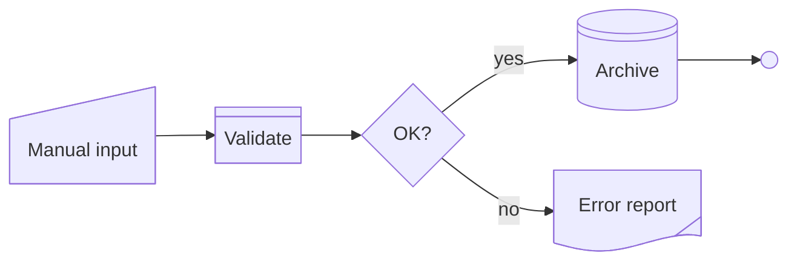

# Shapes

mmdx draws every flowchart shape of Mermaid 11.17 — the 14 bracket forms and all 53 named shapes of `A@{ shape: … }` — and a few more for the other diagram types. One catalogue holds them all: the parser, the renderer, connector ends, the editor's Shapes menu, shape picker and Properties panel, and the theme editor all read it, so a shape looks the same everywhere.

## Writing shapes in Mermaid

A shape is written in the Mermaid code, so the file shows the same shapes in GitHub, on mermaid.live and in any other Mermaid renderer. There are two forms:

```mmdx
flowchart LR
  A["Order received"] --> B{"In stock?"}
  B -->|yes| C["Ship"]
  B -->|no| D["Back order"]
  D@{ shape: lin-cyl }
  C@{ shape: docs, label: "Packing slips" }
```

- **Brackets** — `A["…"]` is a rectangle, `B{"…"}` a diamond, `A(["…"])` a stadium. The table below lists each shape's bracket, where it has one.
- **Node data** — `A@{ shape: lin-cyl }` names any shape. It can be written on the node (`A@{ shape: doc, label: "Report" } --> B`) or as a statement of its own. A later statement wins, as in Mermaid: `D["Back order"]` and then `D@{ shape: lin-cyl }` is a lined cylinder labelled "Back order".

Shape names are Mermaid's short names (`lin-cyl`, `notch-pent`, `bow-rect`) or any of their aliases (`disk`, `loop-limit`, `stored-data`). Mermaid rejects names with capitals or underscores (`lean_r`), and mmdx warns about them with a fix that writes the short name. An unknown name is drawn as a rectangle with a warning — stock Mermaid fails on it.

Everything else in `@{ … }` is kept as written: `icon`, `img`, `w`, `h` and keys mmdx does not use yet survive every edit.



## How the editor writes shapes

Changing a node's shape — in the shape picker, in Properties, or by dropping a shape from the Shapes menu — writes the Mermaid code in the style of Mermaid Chart's editor:

| The node is written as | New shape has a bracket | New shape has none |
|---|---|---|
| `A[Label]` | the brackets change: `A{Label}` | the label stays in its brackets and a statement `A@{ shape: doc }` is added after the graph's statements |
| with `A@{ … }` (on the node or on its own) | `shape` changes in that `@{ … }` | `shape` changes in that `@{ … }` |
| only in edges (`A --> B`) | a definition at its first mention: `A{"A"} --> B` | a statement `A@{ shape: … }` |

The change is one undo step and keeps the selection. Two cases stay in the layout metadata (`%%@ node A {"shape":…}`):

- shapes Mermaid's flowchart does not have (the participant figures such as `actor`, the mindmap's default node), marked "mmdx only" below;
- a node whose preset draws another shape: the preset outranks the code, so the node's own shape goes in its metadata too.

Relabelling, reconnecting or deleting changes only the tokens it must: node data, edge lengths (`--->`), dotted and thick links, chains (`A --> B --> C`), `&` groups and `:::` classes stay as written. A statement is split only where an edit breaks it apart — reconnecting one edge of `A & B --> C` writes that edge on its own and keeps `A --> C` as it was.

### Files from earlier versions

mmdx 0.1–0.3 kept flowchart shapes that Mermaid has no bracket for in the metadata. Such files still draw as before. The code panel lists them as a problem — "N shapes are only in layout data — stock Mermaid shows rectangles" — with a fix that writes all of them to the code. Editing such a node (its shape, its text or a style in Properties) moves its shape too. Opening or saving a file never rewrites its Mermaid on its own.

## Connectors

Connectors end on a shape's outline, not on its box: on the slopes of a diamond or a hexagon, on a circle, on the wave of a document. Ports and magnets in the editor follow the outline as well, and the diff's highlight frames trace it.

## Theme defaults per shape

A theme can give each shape its own default style in `flowchart.nodeShapes`, keyed by the shape's id or by any of its names:

```json
{ "flowchart": { "nodeShapes": { "diamond": { "fill": "@cream" }, "lin-cyl": { "fill": "@pale-blue" } } } }
```

## The catalogue

Shapes are grouped as in the editor: Basic, Process, Technical and Annotation for flowcharts; the figures and media frames belong to the other diagram types (and to icon and image nodes). The id is how metadata, presets and theme keys name a shape: the existing mmdx name for the 17 shapes mmdx drew before (`cylinder`, `parallelogram`), else Mermaid's short name.

### Basic

<ShapeCatalog category="basic" />

### Process

<ShapeCatalog category="process" />

### Technical

<ShapeCatalog category="technical" />

### Annotation

<ShapeCatalog category="annotation" />

### Figures (other diagram types)

The sequence participant figures (Mermaid draws `database` and `queue` participants as the cylinder and the horizontal cylinder) and the mindmap's default node. A flowchart can use them through the metadata.

<ShapeCatalog category="figure" />

### Media

Frames of icon and image nodes.

<ShapeCatalog category="media" />
