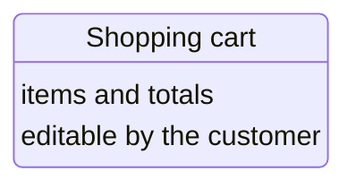
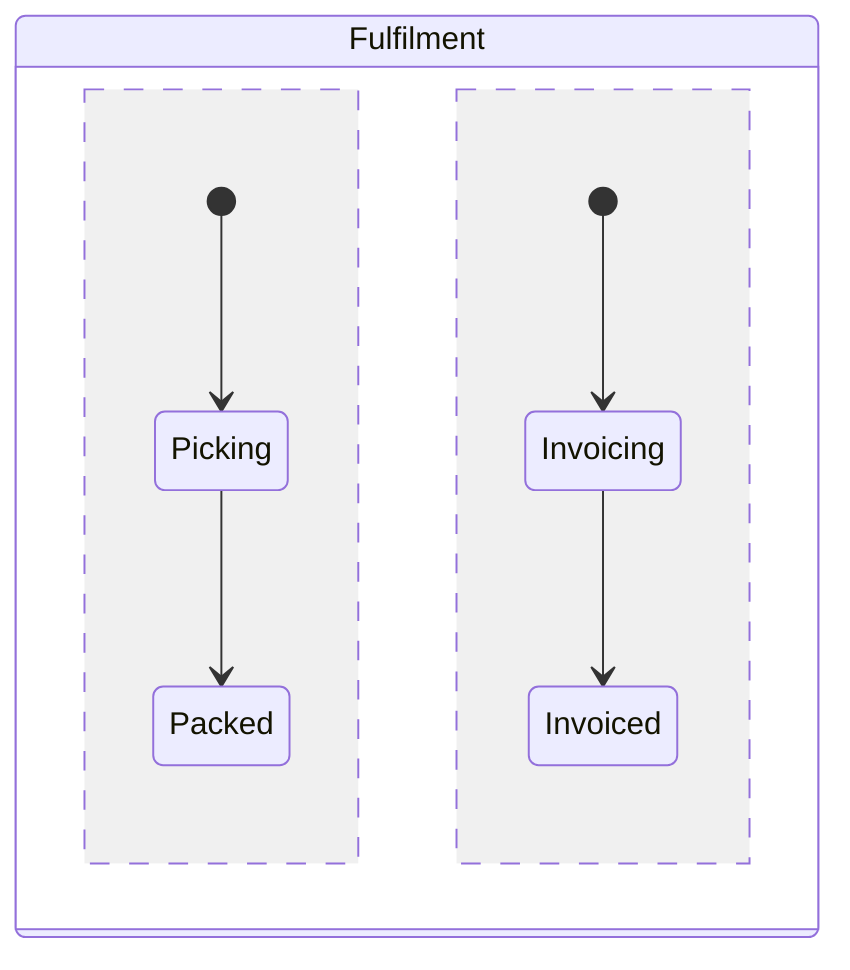
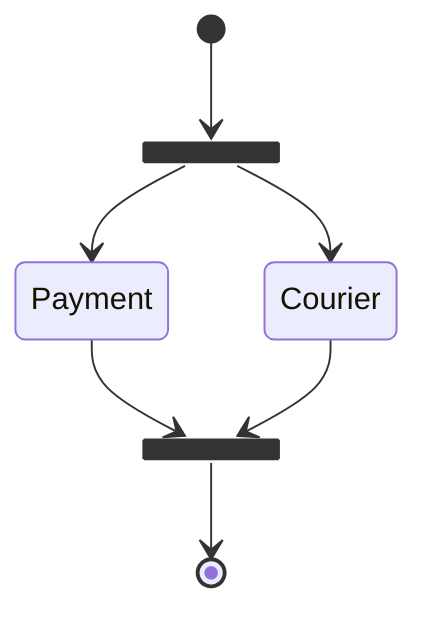

# State diagrams

mmdx reads, draws and edits Mermaid state diagrams (`stateDiagram` and `stateDiagram-v2`), and writes them back as Mermaid code, so a file still opens in stock Mermaid. States, composites and transitions are the flowchart's item kinds (nodes, groups and edges), so selecting, moving, routing, styling, layers and presets work as in a flowchart; the layout is the [compound layout](/components/editor#auto-layout), with each composite and each concurrency region laid out in its own direction. This page lists the syntax mmdx reads, how it draws it, and how the editor changes it; [the editor page](/components/editor#state-diagrams) has the gestures in short.

<MmdxDemo example="order-lifecycle" history controls="zoom code history export theme" />

## Syntax

```mmdx
stateDiagram-v2
  state "Shopping cart" as Cart
  Cart : items and totals
  state stock <<choice>>
  [*] --> Cart
  Cart --> stock : checkout
  stock --> Paid : in stock
  stock --> Waiting : out of stock
  state Paid {
    [*] --> Packing
    --
    [*] --> Invoicing
  }
  Paid --> [*]
  note right of Waiting : restocked within a week
```

mmdx reproduces Mermaid's own lexer for state diagrams (its rules and start conditions, the same in 11.17 and 12.2) over the code as Mermaid's preprocessing leaves it, so a file means the same diagram in both. Both headers read the same; the header is kept as written, and a new diagram starts with `stateDiagram-v2`.

| Syntax | Reads |
|---|---|
| `stateDiagram`, `stateDiagram-v2` | The header; frontmatter, `%%{init}%%` and blank lines may come before it. Without it: `state.header` (error) |
| `Idle` | A state, created by its first mention |
| `state "Waiting for payment" as Waiting` | A state with a title other than its id |
| `Waiting : text` | The state's title when it has none yet, else a description row (see [States](#states-titles-and-description-rows)) |
| `a --> b`, `a --> b : label` | A transition, with a label |
| `[*] --> a`, `a --> [*]` | The start and the end of the scope it is written in (see [Start and end](#start-and-end)) |
| `state Busy { … }`, `state "Busy work" as Busy { … }` | A composite state, nested to any depth; after `state "…" as id` the `{` may be on the next line |
| `--` | Inside a composite: the start of the next concurrency region |
| `state c <<choice>>`, `<<fork>>`, `<<join>>` (also `[[choice]]`, `[[fork]]`, `[[join]]`) | A choice, a fork or a join |
| `note right of a : text`, `note left of a` … `end note` | A note beside a state, a composite or a start, on one line or over several |
| `direction LR` | `TB`, `BT`, `LR`, `RL`: at the top level, the diagram's direction; in a composite, the composite's |
| `classDef name fill:#f00,stroke:#333` | A class |
| `class a, b name`, `a:::name --> b` | Classes of states and composites; `:::` keeps a class only on a transition's ends, as in Mermaid |
| `style a,b fill:#f00` | The style of states and composites |
| `click a "https://…" "Tooltip"`, `click a href "https://…"` | A link (and a tooltip), at the top level only |
| `accTitle: …`, `accDescr: …`, `accDescr { … }`; frontmatter `title:` | The accessible name and description; the title, drawn above the diagram |
| `%% comment`, `# comment` | Comments: a `%%` after `: label` is part of the label, as in Mermaid; after an id it ends the id |
| `hide empty description`, `scale 350 width`, `note "text" as N1` | Accepted and ignored (Mermaid draws nothing for a floating note) |
| `<br/>`, `#9829;`, emoji | A line break, an entity code, emoji as text |

The frontmatter's layout settings (`config.layout`, `config.state` spacing and padding, the same in `%%{init}%%`) are read and ignored, since mmdx lays the diagram out itself.

Mermaid's statement rules are kept, as surprising as some are:

- `;` ends a label: `a --> b : x; y` is the transition `x` and the states `;` and `y`. mmdx reports it (`state.semicolon`) with a fix that writes `;` as `#59;`.
- `direction TD` is not a direction in a state diagram: Mermaid reads the states `direction` and `TD`. mmdx draws what Mermaid draws and reports it (`state.td`) with a fix to `TB`.
- A state's kind comes from its first mention: `state c <<choice>>` after `a --> c` is ignored (`state.kind-late`).
- A state is drawn in the last composite that mentions it; a mention at the top level does not move it out.
- A state mentioned before a `state X { … }` block of the same name becomes that composite; a composite written in two blocks is one composite.
- `state x` alone declares nothing (Mermaid draws no state for it).

### Diagnostics

| Code | Severity | Meaning |
|---|---|---|
| `state.header` | error | The `stateDiagram` / `stateDiagram-v2` header is missing |
| `state.syntax` | error | A line Mermaid cannot read (`a -> b`, `a -->`, `a --> b --> c`, `--` at the top level, an unclosed note…); it is skipped and the next lines are read |
| `state.single-word` | error | `state My State {`: Mermaid wants a single word. The block is still read, as a composite named by the first word |
| `state.unclosed` | error | A composite without its closing `}`; its contents are kept |
| `state.composite-description` | error | A composite with description rows (two or more `X : text` texts): Mermaid fails on it; one title is fine |
| `state.semicolon` | warning | A `;` ended a transition label; fix: write it as `#59;` |
| `state.td` | warning | `direction TD`, which Mermaid reads as two states; fix: use `TB` |
| `state.kind-late` | warning | `<<choice>>`, `<<fork>>` or `<<join>>` after the state's first use, which Mermaid ignores |
| `state.classdef-default` | warning | `classDef default`: stock Mermaid 11.17 and 12.2 fail to parse it; mmdx applies it to every state. Fix: remove the line |
| `state.cross-composite` | warning | A transition between states inside two different composites, which Mermaid does not allow; mmdx draws it |
| `state.bad-style` | warning | A value of `classDef` or `style` that is not valid |

## States, titles and description rows

A state is a rounded box with its title. The title is the first text the code gives the state — `state "Text" as id` or `id : text` — else its id; every further text is a description row, drawn under the title and a divider, left-aligned, with the title in bold:



Labels wrap at 200 px, Mermaid's wrapping width. `**bold**` and `*italic*` are drawn as such, and `<br/>` breaks a line. A composite has one title only (`state.composite-description` otherwise).

## Start and end

`[*]` is a pseudo-state: the start where a transition leaves it, the end where one reaches it. As in Mermaid, there is one start and one end per scope — the top level, each composite and each of a composite's concurrency regions — so a `[*]` inside `state Busy { … }` is Busy's own start or end. Their ids are:

| Pseudo-state | Id |
|---|---|
| Start, end of the top level | `[*]start`, `[*]end` |
| Start, end inside composite X | `X/[*]start`, `X/[*]end` |
| In the n-th region of X (n ≥ 2) | `X/2/[*]start`, `X/2/[*]end`, … |

An id the code gives cannot contain `[*]`, so these never collide with states. In metadata lines they are URI-encoded (`%%@ node %5B*%5Dstart {…}`, `%%@ node Busy%2F%5B*%5Dend {…}`; see [The .mmdx format → Ids](/guide/mmdx-format#ids)). The start is a filled dot, the end a dot in a ring.

## Composites and concurrency

`state X { … }` is a composite state: a rounded frame with its title in a band at the top, holding its states, nested composites and notes. A composite is a transition end of its own (`Validation --> Cancelled`). `--` inside it starts a concurrency region: the regions are separated by dashed lines, and each has its own start and end.



By default composites take the theme's one composite style. The page setting `composites: "palette"` — the **Coloured composites** page preset of the built-in themes — gives each composite a colour of its own, in turn by its place in the code, as Mermaid 12's `redux-color` look does ([Theme file → state](/api/theme-file#state)).

## Choice, fork and join

`state c <<choice>>` is a diamond; `<<fork>>` and `<<join>>` are filled bars across the flow — horizontal in a top-down scope, vertical in a left-right one. Declare the kind before the state's first use: Mermaid keeps the kind of the first mention.



## Notes

`note right of X : text` (or `left of`) puts a folded-corner box beside the state, a composite or a start, joined to it by a dashed line. A note over several lines runs from `note right of X` to `end note`, its common indentation removed. Notes are numbered in code order (`n1`, `n2`…), which is their metadata id (`%%@ note n2 {…}`); the editor keeps a note's metadata with it when notes are added or removed before it, matching it by its state and side.

## Classes, styles and presets

`classDef` and `style` are applied as in Mermaid: `fill`, `stroke`, `color`, `stroke-width`, `stroke-dasharray` and `font-size` (see [Flowchart content → Classes and styles](/guide/flowchart#classes-and-styles)). A class that names a preset — of the theme's `state.nodePresets` (`active`, `done`, `waiting`, `error`, `idle`, `highlight` in the built-in themes), `state.compositePresets` (`plain`, `tinted`, `lane`) or the diagram's own (`%%@ style.node <name>`) — draws the item with that preset instead. A preset chosen in the editor goes into the metadata (`preset`), as do the toolbar's looks; transitions and notes have presets too (`success`, `error`, `async`, `strong`; `info`, `warning`), from the metadata only. A class used but defined nowhere, neither as a `classDef` nor as a preset, is listed in the editor's Problems.

`classDef default` styles every state in mmdx, but stock Mermaid fails to parse a state diagram with it (`state.classdef-default`).

## Direction

`direction LR` at the top level sets the diagram's direction (`TB` without one). Inside a composite it sets the composite's direction; a composite without one is laid out top to bottom, as Mermaid lays it out — unless a transition from outside reaches a state inside it, in which case it follows its parent's direction. `TD` is not a state diagram direction (see [`state.td`](#diagnostics)).

## Links

`click X "https://…" "Tooltip"` and `click X href "https://…"` link a state or a composite; the link goes through the [link policy](/guide/security#link-policy), and the tooltip shows on hover. Mermaid reads `click` at the top level only; the line may name a state inside a composite.

## Icons and images

- **Icons** are label tokens: `fa:fa-car Car`, `tabler:truck Shipping`, in a title, a description row, a transition label or a note, drawn by mmdx through the [icon packs](/guide/icons). Stock Mermaid draws the Font Awesome tokens and shows other packs' as text. The editor's icon picker writes the token at the start of the state's title (`state "fa:fa-car A" as A`).
- **Icon position**: the token is drawn where metadata `iconPos` puts it — inline before the text (`l`, the default), above the title (`t`) or below the text (`b`), at 1.75 em above or below — at metadata `iconSize` (a token with a size of its own is drawn left of the text) and in `iconColor` (a colour or palette reference). The title block grows above the description rows to hold it.
- **Images**: Mermaid's state diagram has no image syntax, so a state's picture is metadata, `%%@ node Packing {"img":"https://example.com/box.png"}`, drawn above the title and the icon: at `imgW` × `imgH` when the metadata gives them (one of them alone keeps the picture's aspect), else at its own size, at most 160 px on its longer side, and 96 × 72 until the browser knows the size; `imgFit` (`contain`, `cover`, `stretch`) is how it fills that box. The URL goes through the [image policy](/guide/security#image-policy); an empty `img` (`""`, a picture not chosen yet) draws the placeholder.
- **Other shapes**: a state's box can be any shape of the [catalogue](/guide/shapes) through metadata `shape` (the toolbar's shape picker writes it); mmdx draws it, stock Mermaid draws the rounded box.

## Layout

mmdx lays a state diagram out with the compound layout: each composite — and each of its concurrency regions — is laid out as a container of its own, in its own direction, then moves as one box in its parent, so composites never overlap each other or other states. Notes sit beside their state, on the side the code gives. Transitions go around composites that hold neither of their ends, and a transition to a composite ends on its frame.

As in a flowchart, a state moved by hand keeps its place (metadata `x` / `y`), a composite resized by hand keeps its frame (`x`, `y`, `w`, `h`), and the auto-placed items are arranged around them; transitions take bend points, ports and routing (`curved`, `orthogonal`, `straight`) from their metadata (`%%@ edge Idle->Busy {…}`). The editor's **Auto layout** and **Reset positions in this group** work as for flowcharts ([Auto layout](/components/editor#auto-layout)).

## Editing

A new state diagram starts from `stateDiagram-v2` (the State diagram card of the editor's "Start a diagram" chooser, the studio's New menu, `starterSource('state')`). The editor writes every change to the Mermaid code where Mermaid's scoping rules let it stand:

- **Shapes menu** (`S`): State, Start, End, Choice, Fork, Join, Composite state and Note. A state, a choice, a fork or a join goes into the composite (and the region) under the drop point, at the end of that scope: `s1`, `state choice1 <<choice>>`, `state fork1 <<fork>>`, `state join1 <<join>>`. A start dropped next to a state writes `[*] --> <state>` in that scope, and is refused ("This scope has a start already", the existing start selected) where the scope has one; an end dropped next to a state writes `<state> --> [*]`, and is refused without a state near it. A note dropped next to a state writes `note left of …` or `note right of … : Note`, the side from where it was dropped. A composite is `state Group1 {` around a new state.
- **Connecting**: drag from a state's or a composite's connection handles to another one. The transition is written in the composite both ends share (in the region they share), else at the top level. A transition into a start or out of an end is refused with the reason, and so is one that would join a composite's start or end to a state outside it. Reconnecting an end rewrites it in place, its label and `:::class` kept, or moves the line to the scope the new ends share.
- **Text**: double-click (or Properties) edits a state's title, a composite's title, a transition's label or a note's text. A title keeps the form it is written in (`state "Text" as id` or `id : text`); a state without one gets `state "Text" as id` before its first mention. Characters Mermaid would end a label at (`;`, `::`, a trailing `:`) are written as entity codes.
- **Properties**: a state's **Kind** (state, choice, fork, join; the `<<…>>` line goes before the state's first mention) and its **Description rows**, one per line, written as `id : row` lines after the title (a state without a title gets one first, since the first text is the title); a composite's **Direction** (Mermaid's default, top to bottom, or `TB`, `BT`, `LR`, `RL`, as its block's first line) and **Add region**, which adds `--` and a new state at the end of the composite; a note's **Side**. The page's Direction writes the top-level `direction` line.
- **Grouping**: ⌘G on states of one scope wraps them in `state Group1 { … }`, with their texts, declarations, notes and the transitions with both ends among them. **Ungroup** unwraps a composite; when it has a start or an end inside, it asks first ("Ungroup the composite?"), then connects the transitions into the composite to the states its start led to, and the transitions out of it from the states that led to its end.
- **Deleting** a state removes its texts, transitions, notes, link and style lines; the other end of a deleted transition stays. Deleting a composite that holds states asks: **Delete with contents**, **Keep contents** (the composite is unwrapped, its inner starts and ends removed) or **Cancel**.
- **Copies**: ⌘C / ⌘V, ⌘D and Alt-drag copy states and composites, with new ids, their texts, kinds and description rows, what the composites hold, and the transitions between the copies.
- **Icons and images**: the icon picker writes a label token at the start of the title; the Image button adds a state with a picture, and the image control sets the selected state's — in metadata `img`. Properties sets the icon's **Position** and **Icon size** and the picture's **Width**, **Height** and **Fit**, in the metadata (`iconPos`, `iconSize`, `imgW`, `imgH`, `imgFit`), the code unchanged.

Every change is one undo step, and every output is code stock Mermaid 11.17 and 12.2 parse (the test suite checks each op against both).

<MmdxDemo kind="editor" example="traffic-light" />

## History and diff

The [diff](/components/diff) and History match states, composites and transitions as in a flowchart: states and composites by id (a removed and an added state with the same title and kind are one renamed state), transitions by their ends, then in order among parallel ones; notes by their state and side, then in order. Start and end pseudo-states are matched by id. A state moved into another composite or another concurrency region is a layout change, as are a composite's direction and number of regions and a note's side; a title, a description row, a kind (state, choice, fork, join), a transition label, a note's text and a link are content; classes, `style`, `classDef` and metadata looks are style. The merged picture keeps a removed state inside its old composite, a removed composite with its contents, and marks changed text word by word.

## What stock Mermaid shows

The same file opens in stock Mermaid (GitHub, GitLab, Mermaid Live) with the same states, composites, regions, transitions and notes — mmdx's model is checked against the one Mermaid 11.17 and 12.2 build — but laid out by Mermaid's own layout. Besides the layout, stock Mermaid:

- fails on `classDef default` (mmdx applies it, with a warning);
- does not allow transitions between states of two different composites (mmdx draws them, with a warning);
- styles a class that names an mmdx preset only if the class has a `classDef`;
- shows icon tokens of packs other than Font Awesome as text;
- draws a start that has a text (`[*] : text`) as a plain state with that text, where mmdx keeps a start;
- knows nothing of the `%%@` metadata: positions, bend points, routing, presets, looks, pictures, catalogue shapes and coloured composites there are mmdx's.

The editor's **Plain Mermaid** preview shows what stock Mermaid draws.
